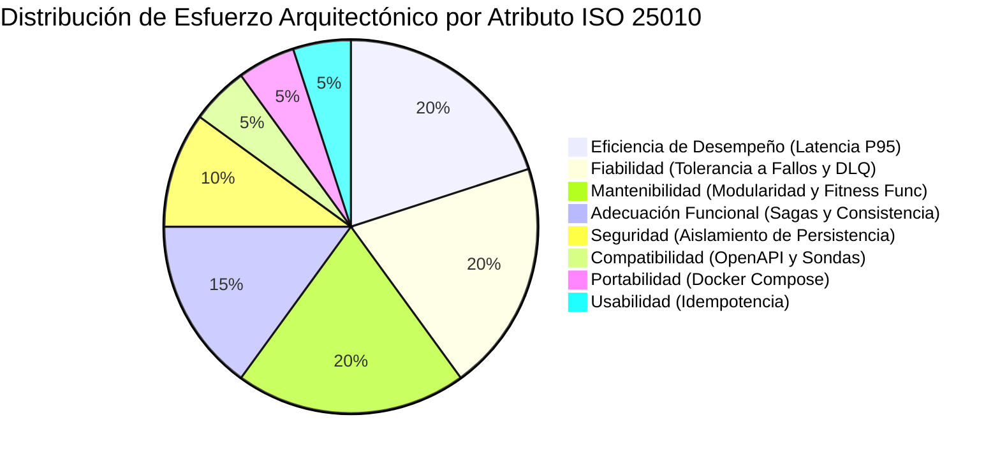

# Matriz de Atributos de Calidad — Estándar ISO/IEC 25010

| Metadato | Detalle |
| :--- | :--- |
| **Rol / Autor** | P11 — Arquitecto de Software |
| **Proyecto** | `fundamentos_arquitectura_politecnico` |
| **Estándar** | ISO/IEC 25010: Systems and software engineering — Software product quality requirements and evaluation (SQuaRE) |
| **Entregable** | Matriz priorizada de atributos de calidad con escenarios arquitectónicos formales |

---

## 1. Definición del Marco de Calidad ISO/IEC 25010

El estándar **ISO/IEC 25010** categoriza las propiedades de calidad del producto de software en ocho características principales. En esta arquitectura distribuida, los atributos han sido priorizados en función del impacto directo en la continuidad del negocio y el éxito operativo de la plataforma de pedidos y pagos.

---

## 2. Matriz Priorizada de Calidad y Escenarios Arquitectónicos

La siguiente tabla desglosa cada característica, subcaracterística, nivel de prioridad y el **Escenario de Arquitectura Formal** correspondiente (Fuente, Estímulo, Artefacto, Entorno, Respuesta y Medida de Respuesta), junto con la **Táctica de Arquitectura** aplicada para garantizar su cumplimiento.

| Característica ISO 25010 | Subcaracterística | Prioridad | Escenario de Arquitectura Formal | Táctica Arquitectónica Aplicada |
| :--- | :--- | :--- | :--- | :--- |
| **1. Eficiencia de Desempeño** | Comportamiento Temporal (Latencia) | **ALTA** | **Fuente:** Cliente comprador. **Estímulo:** Envía solicitud `POST /v1/checkout`. **Artefacto:** `checkout-bff` (8080) y `pedidos-service` (8003). **Entorno:** Operación normal bajo carga de 500 req/s. **Respuesta:** Valida la estructura básica, genera el `pedido_id` en estado `PENDIENTE_PAGO` y retorna respuesta HTTP 202 Accepted. **Medida:** Latencia $P_{95} \le 200\text{ ms}$. | **Comunicación Híbrida y Desacoplamiento:** Aceptación síncrona ligera con procesamiento transaccional diferido vía RabbitMQ (ADR-003). |
| **2. Fiabilidad (Confiabilidad)** | Tolerancia a Fallos y Disponibilidad | **ALTA** | **Fuente:** Pasarela de pagos externa o simulador. **Estímulo:** La pasarela se torna inaccesible o responde con timeout $> 3\text{ s}$. **Artefacto:** `pagos-service` (8004). **Entorno:** Checkout concurrente en ejecución. **Respuesta:** El servicio activa Circuit Breaker, reintenta con backoff exponencial, enruta el mensaje a Dead Letter Queue (DLQ) o dispara la compensación de la saga sin tirar el servicio. **Medida:** Uptime mensual $\ge 99.9\%$; cero bloqueos en hilo principal. | **Patrón Circuit Breaker y Dead Letter Queue (DLQ):** Aislamiento de fallos y reintentos automáticos desacoplados. |
| **3. Mantenibilidad** | Modularidad y Aislamiento | **ALTA** | **Fuente:** Desarrollador / Pipeline CI/CD. **Estímulo:** Intento de modificación de un esquema o consulta a una base de datos ajena. **Artefacto:** `herramientas/validar_fronteras.py` (*Fitness Function*). **Entorno:** Pull Request y build automatizado. **Respuesta:** El script de aptitud detecta la violación arquitectónica y bloquea la integración con código de salida `1`. **Medida:** 100% de cumplimiento del patrón Database-per-Service. | **Database-per-Service y Gobernanza con Fitness Functions:** Persistencia aislada y compuerta en CI (ADR-002). |
| **4. Seguridad** | Integridad y Aislamiento de Persistencia | **ALTA** | **Fuente:** Microservicio o proceso no autorizado. **Estímulo:** Intento de conexión directa a `pagos_db` desde un servicio distinto a `pagos-service`. **Artefacto:** Redes internas Docker / PostgreSQL. **Entorno:** Red de producción/pruebas. **Respuesta:** La base de datos rechaza la conexión por aislamiento de red (`internal: true`) y credenciales exclusivas. **Medida:** 0 accesos cruzados no autorizados a datos de transacciones de pago. | **Principio de Mínimo Privilegio y Redes de Datos Aisladas:** Segregación de redes Docker y credenciales independientes por servicio. |
| **5. Adecuación Funcional** | Corrección Transaccional (Consistencia) | **ALTA** | **Fuente:** Cliente con fondos insuficientes. **Estímulo:** La pasarela rechaza el cobro tras haberse reservado stock. **Artefacto:** Saga distribuida (`pedidos-service`, `inventario-service`, `pagos-service`). **Entorno:** Flujo de compra asíncrono. **Respuesta:** El orquestador ejecuta la compensación: libera la reserva en inventario vía `POST /v1/reservas/{id}/liberar` y cancela el pedido en `pedidos-service`. **Medida:** 100% de consistencia eventual; cero stock retenido indebidamente. | **Patrón Saga Orquestada con Compensaciones Explícitas:** Coordinación basada en eventos y reversiones idempotentes (ADR-001). |
| **6. Compatibilidad** | Interoperabilidad | **MEDIA** | **Fuente:** Validador contractual automatizado. **Estímulo:** Inspección de rutas y tipos de datos de cada microservicio. **Artefacto:** Endpoints `/openapi.json` y sondas de salud. **Entorno:** Verificación de semana 2 / contrato mínimo. **Respuesta:** Cada servicio responde exitosamente en sus rutas pactadas y en sus tres sondas (`/health/live`, `/health/ready`, `/health/startup`). **Medida:** Cumplimiento del 100% del contrato mínimo definido en `contratos/contrato_servicios.json`. | **Estandarización OpenAPI y Health Probes:** Contratos formales de API versionados en repositorio. |
| **7. Portabilidad** | Instalabilidad y Adaptabilidad | **MEDIA** | **Fuente:** Nuevo miembro del equipo o evaluador. **Estímulo:** Ejecución de `docker-compose up -d`. **Artefacto:** `docker-compose.yml` y contenedores oficiales. **Entorno:** Servidor o máquina de desarrollo limpia con Docker Engine. **Respuesta:** Todos los servicios (P01 a P10), bases de datos y broker inician y pasan las sondas de preparación (`/health/ready`). **Medida:** Despliegue funcional completo en menos de 120 segundos sin intervención manual. | **Contenerización Multi-Servicio:** Declaración de infraestructura como código (IaC) con redes y volúmenes persistentes. |
| **8. Usabilidad** | Protección contra Errores (Idempotencia) | **MEDIA** | **Fuente:** Cliente con mala conexión de red. **Estímulo:** Envía dos veces consecutivas la misma solicitud de cobro (`POST /v1/pagos`) con la misma `Idempotency-Key`. **Artefacto:** `pagos-service` (8004). **Entorno:** Conexión intermitente. **Respuesta:** El servicio identifica la llave de idempotencia, no duplica el débito bancario y retorna el resultado de la transacción original. **Medida:** 0 transacciones duplicadas registradas en `pagos_db`. | **Idempotent Consumer Pattern:** Registro y validación previa de llaves de idempotencia en base de datos. |

---

## 3. Síntesis de Priorización para la Arquitectura

Los atributos de **Eficiencia de Desempeño**, **Fiabilidad**, **Mantenibilidad** y **Adecuación Funcional** concentran el mayor peso arquitectónico, lo cual sustenta directamente los tres registros de decisiones arquitectónicas (ADRs) documentados en la siguiente sección.
