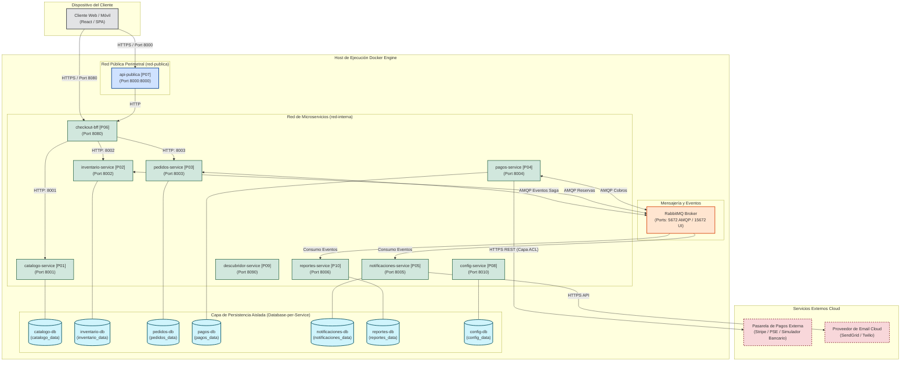

# Diagrama de Despliegue de Infraestructura y Redes

| Metadato | Detalle |
| :--- | :--- |
| **Rol / Autor** | P11 — Arquitecto de Software |
| **Proyecto** | `fundamentos_arquitectura_politecnico` |
| **Topología** | Clúster de Contenedores Docker / Redes Aisladas y Volúmenes Persistentes |

---

## 1. Descripción de la Topología de Despliegue

La plataforma se despliega como un clúster multicontenedor gobernado por `docker-compose.yml`, estructurado en cuatro zonas de aislamiento de red:
1. **Zona Perimetral (`red-publica`):** Expone únicamente el puerto `8000` (`api-publica`) hacia el exterior para recibir el tráfico de clientes y compradores.
2. **Zona de Cómputo Interna (`red-interna`):** Conecta los microservicios de aplicación (Roles P01 a P10) y el broker RabbitMQ (`5672`). Ningún microservicio expone puertos de persistencia hacia el exterior.
3. **Zonas de Persistencia Aisladas (`red-datos-*` con `internal: true`):** Cada base de datos PostgreSQL se ejecuta en su propia red interna sin salida al exterior ni acceso entre bases de datos distintas, garantizando físicamente el principio *Database-per-Service*.
4. **Almacenamiento Persistente (Docker Named Volumes):** Cada motor de base de datos monta su directorio `/var/lib/postgresql/data` en un volumen dedicado (`pedidos_data`, `pagos_data`, etc.), asegurando que el reinicio o actualización de contenedores no provoque pérdida de información.

---

## 2. Diagrama de Despliegue en Mermaid

---

## 3. Código Fuente Versionado
El diagrama de despliegue se encuentra versionado también en formato PlantUML en [`despliegue.puml`](file:///c:/Users/LENOVO/Documents/SimuladorTrafico/docs/arquitectura/diagramas/despliegue.puml).
