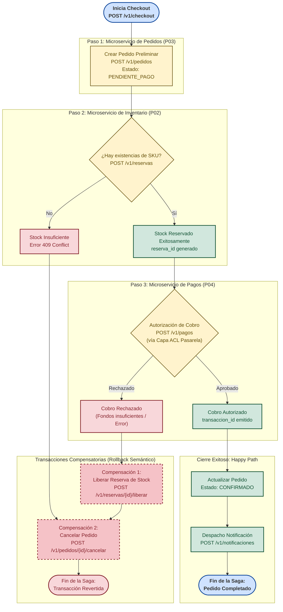

# Diagrama de la Saga Transaccional Distribuida (Mermaid)

| Metadato | Detalle |
| :--- | :--- |
| **Rol / Autor** | P11 — Arquitecto de Software |
| **Proyecto** | `fundamentos_arquitectura_politecnico` |
| **Patrón** | Saga Orquestada con Transacciones Compensatorias (Semantic Rollback) |
| **Herramienta** | Mermaid State & Flowchart Diagram |

---

## 1. Contexto de la Saga en el Checkout

En una arquitectura de microservicios con persistencia aislada (*Database-per-Service*), una transacción que abarca múltiples servicios no puede resolverse con un commit ACID centralizado. El **Patrón Saga** modela la transacción distribuida como una secuencia de transacciones locales coordinadas.

Si alguna transacción local fracasa (por ejemplo, fondos insuficientes en la tarjeta o falta de existencias físicas), el orquestador ejecuta una serie de **transacciones compensatorias** en orden inverso para deshacer semánticamente los cambios efectuados previamente.

---

## 2. Diagrama de Estados y Flujo de la Saga en Mermaid

---

## 3. Matriz de Acciones Transaccionales y Compensatorias

| Paso de la Saga | Microservicio | Acción Transaccional Directa | Endpoint de Acción | Transacción Compensatoria (Rollback) | Endpoint de Compensación |
| :---: | :--- | :--- | :--- | :--- | :--- |
| **1** | `pedidos-service` (8003) | Registrar orden preliminar en estado `PENDIENTE_PAGO`. | `POST /v1/pedidos` | Cancelar orden y marcar estado `CANCELADO`. | `POST /v1/pedidos/{id}/cancelar` |
| **2** | `inventario-service` (8002) | Reservar existencias físicas de los SKUs solicitados. | `POST /v1/reservas` | Liberar la reserva y restaurar las existencias. | `POST /v1/reservas/{reserva_id}/liberar` |
| **3** | `pagos-service` (8004) | Procesar cobro bancario vía Capa Anti-Corrupción (ACL). | `POST /v1/pagos` | Reembolsar cargo financiero acreditado. | `POST /v1/pagos/{pago_id}/reembolso` |
| **4** | `notificaciones-service` (8005) | Enviar correo/SMS de confirmación final. | `POST /v1/notificaciones/prueba` | Enviar alerta de cancelación o fallo de compra al cliente. | N/A (Operación idempotente terminal) |

---

## 4. Garantías de Concurrencia e Idempotencia
1. **Idempotencia de Compensaciones:** Todos los endpoints de compensación (`/liberar`, `/cancelar`, `/reembolso`) son estrictamente **idempotentes**. Si un evento de compensación es entregado dos veces debido a reintentos en RabbitMQ, el resultado en la persistencia es idéntico y seguro.
2. **Expiración de Reservas (TTL):** Toda reserva de stock en `inventario-service` cuenta con un tiempo de vida (*Time-to-Live*) de 10 minutos. Si el orquestador sufre una desconexión crítica antes de completar o compensar la saga, un cron interno en `inventario-service` libera automáticamente el stock retenido.
