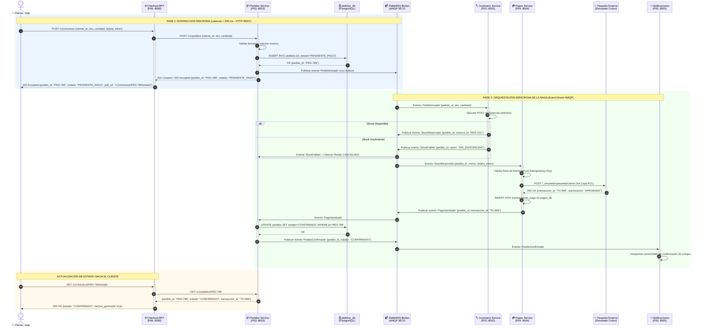

# Diagrama de Secuencia del Checkout: Fase Síncrona vs. Asíncrona

| Metadato | Detalle |
| :--- | :--- |
| **Rol / Autor** | P11 — Arquitecto de Software |
| **Proyecto** | `fundamentos_arquitectura_politecnico` |
| **Objetivo** | Modelar el flujo transaccional de checkout diferenciando con precisión milimétrica la interacción síncrona en el borde de la ejecución asíncrona distribuida en el núcleo |

---

## 1. Justificación Arquitectónica de la Separación Síncrono / Asíncrono

Para cumplir con el **RNF-01 (Latencia $P_{95} \le 200\text{ ms}$)** y el **RNF-02 (Disponibilidad $\ge 99.9\%$)**, el proceso de checkout no puede esperar síncronamente por la confirmación de la pasarela bancaria externa ni por el envío de correos electrónicos. 

Se divide el flujo en dos fases claramente delimitadas:
1. **Fase Síncrona (Inmediata / Borde):** Captura la intención de compra del cliente, valida la estructura del payload, genera el `pedido_id` en estado preliminar `PENDIENTE_PAGO` y retorna una respuesta HTTP 202 Accepted en menos de 200 ms.
2. **Fase Asíncrona (Segundo Plano / Núcleo):** Coordina la reserva de stock, el cobro financiero a través de la Capa ACL y el envío de notificaciones mediante eventos asíncronos en RabbitMQ bajo el patrón Saga.

---

## 2. Diagrama de Secuencia UML (Mermaid)

---

## 3. Código Fuente Versionado en PlantUML

Para compatibilidad con compiladores estándar de PlantUML, el diagrama se encuentra versionado en [`docs/arquitectura/diagramas/secuencia-checkout.puml`](file:///c:/Users/LENOVO/Documents/SimuladorTrafico/docs/arquitectura/diagramas/secuencia-checkout.puml).
