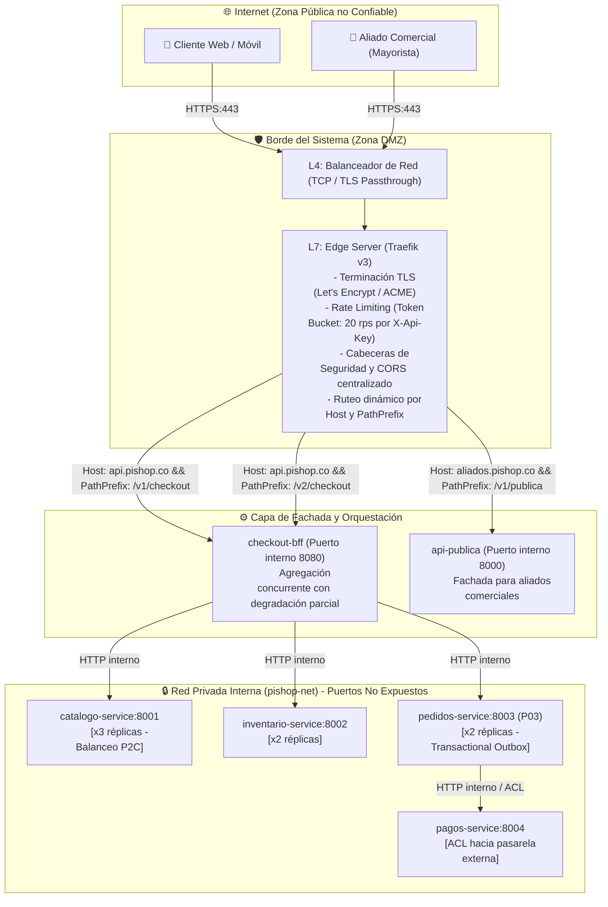

# Entregable 4 — Diseño del Edge Server, Topología del Borde y API Pública

**Curso:** Fundamentos de Arquitectura (1419)  
**Proyecto:** PiShop Cloud  
**Semana:** 5 — Enrutamiento Dinámico, Balanceo de Carga y Edge Server  
**Autor:** José Luis Pineda Sanabria (P03 — `pedidos-service`)  

---

## 1. Topología del Borde y Frontera de Confianza

El sistema implementa una arquitectura en capas con un **Edge Server L7 (Traefik v3)** que actúa como único punto de entrada público, aislando los servicios core dentro de una red privada (`pishop-net`). Ningún servicio core expone puertos directamente a Internet o a la máquina anfitriona.

### Diagrama de Topología (Mermaid)

---

## 2. Tabla de Ruteo Dinámico y Políticas de Tráfico

| Ruta Pública (Host + Path) | Destino Interno | Algoritmo de Balanceo | Middlewares Aplicados | Política de Cuota (Rate Limit) |
|---|---|---|---|---|
| `api.pishop.co/v1/checkout` | `checkout-bff:8080` | Round-Robin | `sec-headers`, `cors-tienda` | 50 rps sostenido, ráfagas hasta 100 por IP |
| `api.pishop.co/v2/checkout` | `checkout-bff:8080` | Round-Robin | `sec-headers`, `cors-tienda` | 50 rps sostenido, ráfagas hasta 100 por IP |
| `aliados.pishop.co/v1/pedidos` | `api-publica:8000` | P2C (*Power of Two Choices*) | `sec-headers`, `auth-api-key`, `rl-aliados` | 20 rps sostenido, ráfaga máx 40 por `X-Api-Key` |
| `aliados.pishop.co/v1/catalogo` | `catalogo-service:8001` | Consistent Hashing (por `sku`) | `sec-headers`, `strip-prefix` | 100 rps sostenido por `X-Api-Key` |
| `*.pishop.co:8003` (directo) | **BLOQUEADO (Conexión rechazada)** | N/A | **Sin publicación de puertos hacia host** | Acceso externo no permitido (Regla de oro L7) |

### Middlewares de Seguridad y CORS (Traefik v3)
- `sec-headers`: `HSTS (max-age=31536000)`, `X-Frame-Options: DENY`, `X-Content-Type-Options: nosniff`, `Referrer-Policy: no-referrer`.
- `cors-tienda`: Origen permitido exclusivo `https://tienda.pishop.co`, métodos `GET, POST, OPTIONS`, preflight max-age 86400s.
- `rl-aliados`: Token Bucket con `sourceCriterion.requestHeaderName = X-Api-Key` para evitar castigar a clientes bajo NAT.

---

## 3. Architecture Decision Record (ADR 004)

### Título: ADR 004 — Diseño del Edge Server, Algoritmos de Balanceo y Decisión de Service Mesh

**Fecha:** Noviembre de 2026  
**Estado:** Aprobado  
**Autores:** Equipo de Arquitectura PiShop Cloud  

### Contexto
PiShop Cloud ha completado la migración de su núcleo a microservicios autónomos. Se requiere diseñar el borde de red (Edge Server) para gestionar el tráfico de usuarios finales y aliados comerciales, asegurando balanceo eficiente, versionado transparente y mínimo sobrecosto operacional.

### Decisiones y Justificaciones

#### 1. Algoritmo de Balanceo: Power of Two Random Choices (P2C) por defecto
* **Decisión:** Adoptar P2C (o Peak EWMA) como algoritmo de balanceo interno entre réplicas de servicios core.
* **Alternativa descartada:** Round-Robin simple y Least-Connections global.
* **Justificación técnica:** Round-Robin es ciego a la latencia observada; si una instancia sufre contención de disco, sigue recibiendo 1/N de la carga, degradando la experiencia. Least-Connections global exige estado sincronizado y sufre del "efecto manada" (múltiples balanceadores saturan juntos la misma instancia ociosa). P2C selecciona dos réplicas al azar en $O(1)$ y entrega la petición a la de menor latencia móvil (EWMA). La matemática demuestra una reducción exponencial de la cola máxima esperada ($\approx \frac{\ln \ln N}{\ln 2}$) con costo de coordinación cero.

#### 2. Estrategia de Versionado: Versionado por URI (`/v1` y `/v2`)
* **Decisión:** Utilizar versionado explícito en la ruta URI (`/v1/...` y `/v2/...`).
* **Alternativa descartada:** Versionado por cabeceras HTTP personalizadas (`X-API-Version`) o negociación de contenido (`Accept: application/vnd.pishop.v2+json`).
* **Justificación técnica:** Los consumidores de PiShop Cloud incluyen cooperativas y PYMES agrícolas que utilizan herramientas cliente sencillas. El versionado por URI es directamente visible en logs, cacheable por proxies intermedios y trivial de enrutar dinámicamente en Traefik mediante `PathPrefix`. La deprecación se gestiona de forma estándar según RFC 8594 y RFC 9745 emitiendo cabeceras `Sunset: <fecha>` y `Deprecation: @<timestamp>`.

#### 3. Decisión de Service Mesh: NO adoptar Service Mesh en esta fase
* **Decisión:** Descartar el uso de Service Mesh (Istio o Linkerd) en el estado actual de la plataforma.
* **Alternativa descartada:** Despliegue de Istio Ambient Mode o Cilium eBPF L7.
* **Justificación técnica:** PiShop Cloud opera con 7 servicios desarrollados en Python bajo un solo equipo de ingeniería. La complejidad operativa, huella de memoria y dificultad de depuración de un Service Mesh (*microservice premium*) superan con creces sus beneficios. La seguridad del perímetro queda resuelta en Traefik v3 (terminación TLS y rate limiting) y la resiliencia interna se maneja a nivel de aplicación mediante `httpx` (timeouts explícitos, circuit breakers y reintentos). Se reevaluará únicamente si el ecosistema escala a más de 30 servicios o si surge un requerimiento normativo estricto de mTLS Zero Trust entre pods.

---

## 4. Aislamiento y Seguridad de `pedidos-service` (P03)

Siguiendo el principio de mínima exposición:
1. `pedidos-service` corre en el puerto 8003 dentro del contenedor.
2. En producción / Docker Compose, **no se publica el puerto al host** (`ports: ["8003:8003"]` se elimina o se comenta).
3. Cualquier intento de consumo externo directo a `http://<ip-servidor>:8003/v1/pedidos` resulta en **conexión rechazada**.
4. El único canal válido de acceso es a través de `checkout-bff` (vía red interna Docker `pishop-net`), el cual aplica las políticas de autenticación, rate limit y validación previa de la saga de compra.
