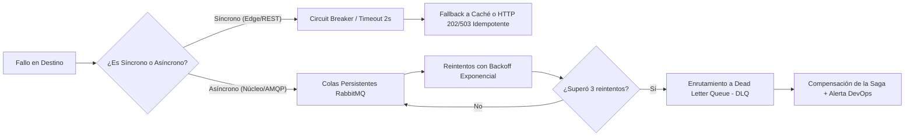

# Matriz de Modos de Comunicación y Resiliencia ante Fallos

| Metadato | Detalle |
| :--- | :--- |
| **Rol / Autor** | P11 — Arquitecto de Software |
| **Proyecto** | `fundamentos_arquitectura_politecnico` |
| **Objetivo** | Documentar todos los canales de comunicación entre servicios, modos de interacción, protocolos y tácticas de resiliencia ante caídas del destino |

---

## 1. Principios de Comunicación del Ecosistema
1. **Desacoplamiento Perímetro vs. Núcleo:** Las solicitudes iniciadas por el usuario son síncronas en el perímetro (Ingress / BFF), mientras que la coordinación entre microservicios del núcleo transaccional se realiza de forma asíncrona mediante el broker RabbitMQ.
2. **Resiliencia Basada en Aislamiento de Fallos:** Si un servicio destino colapsa, el servicio origen nunca debe bloquear sus hilos indefinidamente. Se emplean Circuit Breakers, colas de descarte/reintento (Dead-Letter Queues) y almacenamiento local previo mediante el patrón Transactional Outbox.

---

## 2. Matriz Exhaustiva de Comunicación Inter-Servicios

| Par de Servicios (Origen $\to$ Destino) | Modo de Comunicación | Protocolo y Puerto | ¿Qué pasa si el destino cae? (Táctica de Resiliencia) | Impacto en el Usuario Final |
| :--- | :--- | :--- | :--- | :--- |
| **Cliente $\to$ `api-publica`** | Síncrono (Request/Response) | HTTPS / JSON REST (Puerto `8000`) | El cliente experimenta error de conexión `503 Service Unavailable`. El Load Balancer / Nginx reintenta con otra réplica si existe. | El cliente no puede acceder temporalmente a la tienda; se sugiere reintentar en unos segundos. |
| **Cliente $\to$ `checkout-bff`** | Síncrono (Request/Response) | HTTPS / JSON REST (Puerto `8080`) | El frontend captura timeout (máximo 3 s) y muestra pantalla de espera amigable (*graceful degradation*). | El cliente es informado de congestión temporal; no se pierde información ya que el carrito reside en cliente/local storage. |
| **`api-publica` $\to$ `checkout-bff`** | Síncrono (In-Cluster) | HTTP / REST (Puerto `8080`) | `api-publica` activa un **Circuit Breaker** (umbral: 5 fallos en 10 s). Si abre el circuito, responde HTTP 504 Gateway Timeout de inmediato sin agotar recursos. | El usuario recibe error inmediato en lugar de pantalla congelada. |
| **`api-publica` $\to$ `catalogo-service`** | Síncrono (Lectura) | HTTP / REST (Puerto `8001`) | `api-publica` implementa **Caché en Memoria / Redis con Fallback**; si el catálogo cae, responde con la última versión de productos en caché (TTL 5 min). | El usuario continúa navegando productos en modo degradado sin percatarse de la caída de `catalogo-service`. |
| **`checkout-bff` $\to$ `catalogo-service`** | Síncrono (Lectura Vitrina) | HTTP / REST (Puerto `8001`) | Timeout estricto de 1.5 s. Si cae, `checkout-bff` responde con el catálogo localmente en caché. | Los clientes siguen viendo artículos disponibles; la actualización de precios se pospone hasta la recuperación. |
| **`checkout-bff` $\to$ `pedidos-service`** | Síncrono (Creación de Orden) | HTTP / REST (Puerto `8003` - `POST /v1/pedidos`) | Timeout de 2 s. Si `pedidos-service` no responde, el BFF retorna `HTTP 503`. El cliente reintenta la misma petición con la misma cabecera `Idempotency-Key`. | El checkout no se duplica gracias a la validación de idempotencia en `pedidos-service`. |
| **`pedidos-service` $\to$ `pedidos-db`** | Síncrono (Persistencia) | TCP / PostgreSQL Wire (Puerto `5432`) | El pool de conexiones (HikariCP / SQLAlchemy) reintenta 3 veces con backoff exponencial. Si persiste caído, el endpoint de salud `/health/ready` pasa a estado `DOWN`, sacando a `pedidos-service` del balanceador. | El servicio no acepta nuevas órdenes corruptas. Se protege la integridad relacional de `pedidos_db`. |
| **`pedidos-service` $\to$ `rabbitmq`** | Asíncrono (Transactional Outbox) | AMQP 0-9-1 (Puerto `5672`) | Si RabbitMQ no está disponible, `pedidos-service` persiste el evento en su tabla local `outbox_pendientes` dentro de la misma transacción de base de datos. Un hilo de fondo reintenta publicar cuando RabbitMQ vuelva a estar activo. | **Cero impacto en el usuario.** El checkout síncrono retorna `202 Accepted` y los eventos se publican tan pronto se restaura el broker. |
| **`rabbitmq` $\to$ `inventario-service`** | Asíncrono (Consumer Event) | AMQP 0-9-1 (Cola: `q.inventario.reservas`) | Si `inventario-service` está caído, los mensajes permanecen retenidos de forma segura en la cola durable de RabbitMQ. Al reiniciar el servicio, consume los eventos encolados en orden. | La reserva de stock se demora unos segundos pero no se pierde la orden de compra. |
| **`inventario-service` $\to$ `inventario-db`** | Síncrono (Persistencia) | TCP / PostgreSQL Wire (Puerto `5432`) | Si la base de datos de inventario cae, el consumidor de RabbitMQ rechaza el mensaje con `nack(requeue=true)` hasta 3 veces; luego lo redirige a la cola Dead Letter Queue (`q.inventario.dlq`) para análisis manual. | Se previene la sobreventa de productos; el equipo de soporte inspecciona la DLQ. |
| **`rabbitmq` $\to$ `pagos-service`** | Asíncrono (Consumer Event) | AMQP 0-9-1 (Cola: `q.pagos.procesar`) | Los mensajes de cobro se acumulan en la cola persistente de RabbitMQ sin pérdida de mensajes hasta que `pagos-service` vuelva a estar listo. | El usuario ve su orden en estado `PENDIENTE_PAGO` en el polling hasta que el cobro se reanude. |
| **`pagos-service` $\to$ `pagos-db`** | Síncrono (Persistencia) | TCP / PostgreSQL Wire (Puerto `5432`) | Sonda `/health/ready` marca `FAIL`. Las transacciones no se cobran si no pueden quedar auditadas en base de datos. | Se evitan discrepancias contables. |
| **`pagos-service` $\to$ Pasarela Externa** | Síncrono (vía Capa ACL) | HTTPS / JSON REST (`/_simulador/pasarela/cobrar`) | **Timeout de 3 s + Circuit Breaker en la Capa ACL.** Si la pasarela responde con error `5xx` o timeout continuo, la ACL dispara compensación de la saga o marca la transacción como `PENDIENTE_REVISION_MANUAL`. | El cliente no queda con cobros fantasma; se cancela la orden y se libera el stock retenido. |
| **`rabbitmq` $\to$ `notificaciones-service`**| Asíncrono (Consumer Event) | AMQP 0-9-1 (Cola: `q.notificaciones.despacho`) | Los mensajes permanecen retenidos en RabbitMQ. Si falla persistentemente el envío SMTP/SMS, el mensaje pasa a `q.notificaciones.dlq`. | El cliente experimenta una leve demora en el correo de confirmación, pero la compra se procesó exitosamente. |
| **`rabbitmq` $\to$ `reportes-service`** | Asíncrono (Consumer CQRS) | AMQP 0-9-1 (Cola: `q.reportes.ventas`) | Si el servicio de analítica cae, los eventos de ventas se retienen en RabbitMQ. Al restablecerse, se procesa la cola y se reconstruyen las métricas agregadas vía `POST /v1/reportes/reconstruir`. | **Impacto nulo en el cliente final.** Solo los reportes administrativos internos se actualizan con retraso. |
| **Cualquier Servicio $\to$ `config-service`** | Síncrono (Inicio / Carga de Parámetros) | HTTP / REST (Puerto `8010`) | Cada servicio mantiene una copia local de respaldo de su configuración en disco (`config.local.json`). Si `config-service` está caído, inicia con los valores cacheados por defecto. | Disponibilidad no bloqueada durante el despliegue. |
| **Cualquier Servicio $\to$ `descubridor-service`**| Síncrono (Resolución DNS/Red) | HTTP / REST (Puerto `8090`) | Cada microservicio implementa caché de resolución de nombres en memoria con TTL de 60 s y fallback a resolución DNS nativa de Docker Bridge (`http://pedidos-service:8003`). | La comunicación inter-servicios continúa fluida sin caídas generalizadas. |

---

## 3. Resumen de Tácticas de Resiliencia Adoptadas

