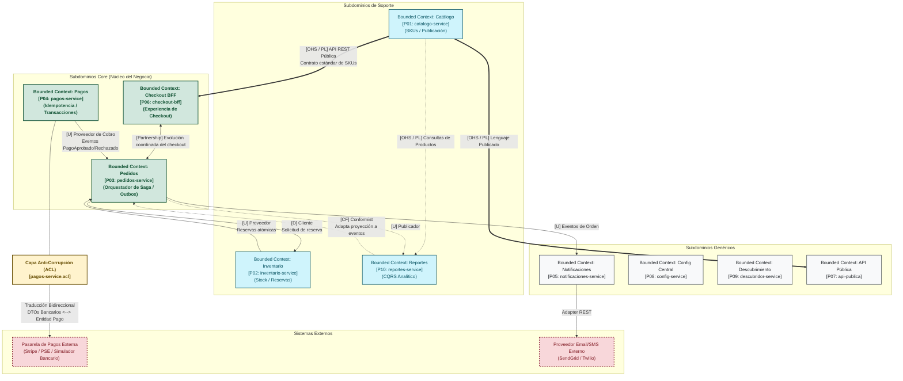

# Subdominios DDD y Mapa de Contextos (Context Map)

| Metadato | Detalle |
| :--- | :--- |
| **Rol / Autor** | P11 — Arquitecto de Software |
| **Proyecto** | `fundamentos_arquitectura_politecnico` |
| **Enfoque** | Diseño Guiado por el Dominio (Domain-Driven Design - DDD) |
| **Entregables** | Tabla de Subdominios (Core, Soporte, Genérico), Context Map en Mermaid con 3+ patrones DDD y Justificación de la Capa Anti-Corrupción (ACL) |

---

## 1. Tabla Estratégica de Subdominios

En consonancia con los principios de Domain-Driven Design (DDD), el espacio del problema se descompone en subdominios clasificados según su valor competitivo, diferenciación estratégica en el mercado y complejidad intrínseca.

| Subdominio | Tipo | Rol / Microservicio Asociado | Descripción de Responsabilidades de Negocio | Diferenciador Estratégico y Justificación |
| :--- | :--- | :--- | :--- | :--- |
| **Pedidos y Checkout** | **Core Domain (Núcleo)** | `P03: pedidos-service`<br>`P06: checkout-bff` | Gestiona el embudo transaccional de compra, la creación formal de órdenes, el cálculo de totales y la orquestación del estado de la Saga distribuida. | **Máximo valor de negocio.** Es el motor de conversión de la compañía. Una falla en este subdominio detiene de inmediato los ingresos de la plataforma. |
| **Pagos y Liquidación** | **Core Domain (Núcleo)** | `P04: pagos-service` | Procesa cobros financieros, garantiza idempotencia, ejecuta compensaciones/reembolsos y reconcilia transacciones monetarias. | **Crítico para la supervivencia y confianza.** Maneja el flujo de capital y la relación contractual con los bancos y el comprador. |
| **Inventario y Existencias** | **Supporting Domain (Soporte)** | `P02: inventario-service` | Controla el stock físico de SKUs, ejecuta reservas atómicas durante la compra y libera existencias ante fallos de pago. | **Esencial pero no diferenciador.** Da soporte directo al flujo de pedidos para evitar sobreventa (*overselling*). |
| **Catálogo de Productos** | **Supporting Domain (Soporte)** | `P01: catalogo-service` | Administra la definición de productos, SKUs, categorías, atributos comerciales y estados de publicación. | **Soporte comercial.** Estructura los productos para su visualización y selección, sirviendo de insumo a la vitrina. |
| **Analítica y Reportes** | **Supporting Domain (Soporte)** | `P10: reportes-service` | Proyecta resúmenes de rendimiento comercial, ventas por SKU y métricas agregadas bajo patrón CQRS. | **Inteligencia de negocio.** Permite a los stakeholders tomar decisiones tácticas sin impactar la base transaccional de pedidos. |
| **Notificaciones Transaccionales** | **Generic Domain (Genérico)** | `P05: notificaciones-service` | Despacho multicanal de correos electrónicos y mensajes SMS confirmando estados de compra y cobro. | **Genérico y comoditizado.** Puede ser provisto por herramientas SaaS del mercado (SendGrid, Twilio) sin ventaja competitiva única. |
| **Configuración Centralizada** | **Generic Domain (Genérico)** | `P08: config-service` | Almacenamiento versionado de configuraciones y soporte de rollbacks de variables operativas. | **Utilidad técnica transversal.** Infraestructura estándar para desacoplar variables operativas del ciclo de despliegue. |
| **Descubrimiento y Registro** | **Generic Domain (Genérico)** | `P09: descubridor-service` | Directorio en memoria para resolución dinámica de instancias y puertos de servicios en el clúster. | **Utilidad técnica transversal.** Facilita la localización de servicios sin acoplamiento a IPs fijas. |
| **Ingress y Exposición Pública** | **Generic Domain (Genérico)** | `P07: api-publica` | Puerta de enlace perimetral, enrutamiento público y normalización de compras externas. | **Control perimetral.** Patrón estándar de Gateway para aislar la topología interna. |

---

## 2. Mapa de Contextos (Context Map) en Mermaid

El siguiente diagrama modela formalmente los **Bounded Contexts (Contextos Delimitados)** de la arquitectura, sus fronteras y los patrones de relación e integración estratégica existentes entre ellos.



---

## 3. Patrones de Relación DDD Implementados

En el mapa de contextos anterior se han formalizado de manera explícita cuatro patrones de integración estratégica de Domain-Driven Design:

### 3.1 Patrón 1: Customer-Supplier (Cliente-Proveedor / Upstream [U] - Downstream [D])
- **Participantes:** `Inventario Context [U]` y `Pedidos Context [D]`; `Pagos Context [U]` y `Pedidos Context [D]`.
- **Dinámica:** El contexto de `Pedidos` actúa como cliente (*Downstream* $[D]$) y depende de los servicios proveedores (*Upstream* $[U]$) de inventario y pagos para completar satisfactoriamente la transacción de checkout. Las prioridades del cliente son atendidas por el proveedor según los contratos de reserva (`/v1/reservas`) y pago (`/v1/pagos`). Si el proveedor falla, el cliente ejecuta transacciones compensatorias.

### 3.2 Patrón 2: Partnership (Sociedad / Cooperación Bidireccional $[P] \leftrightarrow [P]$)
- **Participantes:** `Checkout BFF` y `Pedidos Context`.
- **Dinámica:** Ambos contextos pertenecen al núcleo de la experiencia de compra y deben evolucionar en perfecta sincronía. Los cambios en el flujo de checkout impactan directamente a la creación del pedido y viceversa. No existe subordinación estricta; cualquier modificación en el contrato de API se acuerda conjuntamente mediante pruebas de integración conjuntas.

### 3.3 Patrón 3: Open Host Service / Published Language (OHS / PL)
- **Participantes:** `Catálogo Context` hacia `Checkout BFF`, `API Pública` y `Reportes`.
- **Dinámica:** El contexto de Catálogo expone un protocolo de acceso público y estandarizado (**Open Host Service**) mediante endpoints REST abiertos (`/v1/productos`, `/v1/productos/{sku}`) y un esquema de intercambio unificado (**Published Language**) basado en OpenAPI 3.0. De este modo, múltiples consumidores heterogéneos acceden a la información de los productos sin requerir integraciones propietarias punto a punto.

### 3.4 Patrón 4: Conformist (Conformista $[CF]$)
- **Participantes:** `Reportes Context [CF]` con respecto a `Pedidos Context [U]`.
- **Dinámica:** El contexto de analítica y reportes CQRS se conforma enteramente al modelo y esquema de eventos emitidos por el orquestador de pedidos y pagos (`PedidoCreado`, `PagoAprobado`), consumiéndolos para alimentar sus tablas de resumen sin exigir cambios al dominio transaccional de origen.

---

## 4. Justificación Técnica de la Capa Anti-Corrupción (ACL)

El microservicio de pagos (`pagos-service [P04]`) incorpora obligatoriamente una **Capa Anti-Corrupción (Anticorruption Layer - ACL)** para comunicarse con la pasarela de pagos externa (simulador bancario o proveedores como Stripe/PSE).

### 4.1 Problema de Acoplamiento y Contaminación
Las pasarelas bancarias externas operan con:
1. Modelos de datos ajenos con nomenclaturas arbitrarias (`charge_id`, `stripe_token`, `auth_code_iso8583`, importes en centavos `amount_cents`).
2. Protocolos heterogéneos y códigos de respuesta crípticos (`DECLINED_05`, `INSUFFICIENT_FUNDS_51`, `TIMEOUT_91`).
3. Cambios intempestivos de versiones de API externas y formatos de webhook.

Si el modelo de dominio interno de `pagos-service` adoptara directamente estas estructuras, el dominio core quedaría irremediablemente contaminado, acoplándose a la tecnología y contratos del proveedor externo.

### 4.2 Arquitectura y Componentes de la ACL
La ACL se sitúa como una frontera protectora compuesta por tres elementos:
```
[ Dominio Interno Pagos ]
        ▲
        │ Entidad: Pago (id, pedido_id, monto: Decimal, estado: Aprobado/Rechazado)
        ▼
[ Interfaz: PasarelaPagoPort ] ◄── (Puerto de Dominio - Hexagonal)
        ▲
        │
┌───────┴───────────────────────────────────────────────────────┐
│              CAPA ANTI-CORRUPCIÓN (ACL)                       │
│                                                               │
│  1. PasarelaPagoAdapter (Implementa PasarelaPagoPort)         │
│  2. PasarelaTranslator:                                       │
│     - Traduce PagoDTO -> ExternalBankPayload                  │
│     - Sanitiza y mapea errores bancarios -> Excepciones Pago │
│  3. PasarelaHttpClient:                                       │
│     - Manejo de timeouts (2.5s), reintentos con backoff       │
│     - Cifrado y cabeceras seguras                             │
└───────────────────────────────┬───────────────────────────────┘
                                ▼
         [ API Pasarela Externa / _simulador/pasarela/cobrar ]
```

### 4.3 Beneficios y Justificación de Negocio
- **Aislamiento Total del Dominio:** Si la pasarela modifica su payload JSON o añade campos obligatorios, únicamente se actualiza el `PasarelaTranslator`. El modelo de dominio, la base de datos `pagos_db` y los eventos de dominio permanecen inalterados.
- **Independencia de Proveedor (Mitigación de Vendor Lock-in):** Es posible sustituir el simulador bancario por Stripe, PSE o MercadoPago sin modificar una sola línea de la lógica de negocio ni de la base de datos de pagos.
- **Normalización de Respuestas:** La ACL traduce los más de 50 códigos de rechazo bancario a tres estados canónicos del dominio: `APROBADO`, `RECHAZADO_SALDO_INSUFICIENTE` y `FALLO_COMUNICACION_TEMPORAL`.
