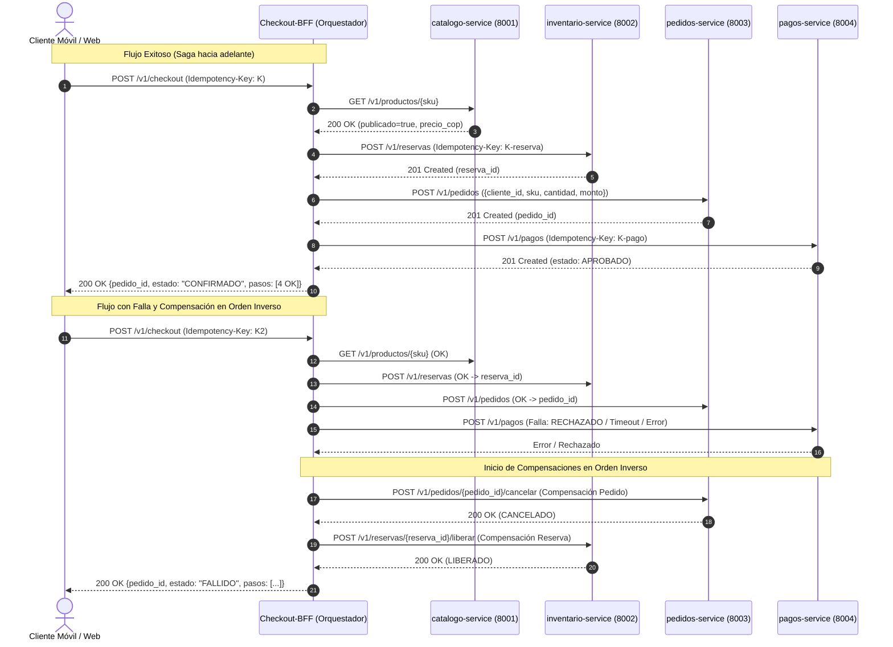

# checkout-bff (P06) — servicio compuesto y orquestador de saga de PiShop Cloud

Autor: Johan Sebastian Rubiano Guzmán · Paquete P06 · Fundamentos de Arquitectura (1419)

Servicio compuesto (Backend For Frontend - BFF) que implementa el patrón **Saga por Orquestación** para coordinar el flujo de compras de PiShop Cloud a través de los servicios de catálogo, inventario, pedidos y pagos. Incluye agregación de datos para la vista móvil (`/v1/vitrina`), compensaciones automáticas ante fallos y control estricto de concurrencia e idempotencia.

---

## Endpoints
| Método | Ruta | Descripción |
|---|---|---|
| POST | `/v1/checkout` | Orquesta la saga de compra (valida catálogo → reserva inventario → crea pedido → cobra). Requiere obligatoriamente `Idempotency-Key` |
| GET | `/v1/checkout/{pedido_id}/estado` | Consulta el estado del checkout y el detalle de pasos/compensaciones ejecutadas |
| GET | `/v1/vitrina` | Agregador BFF: combina productos publicados de catálogo con su stock disponible para móvil (con degradación graciosa) |
| GET | `/health/live` | Sonda de vida (local, barata, nunca toca dependencias) |
| GET | `/health/ready` | Sonda de preparación (verifica arranque y versión de configuración) |
| GET | `/health/startup` | Sonda de inicio (indica si el ciclo de vida del servicio ya arrancó) |

---

## Cómo ejecutarlo

### Requisitos previos
* **Python 3.10+** (probado y validado en Python 3.13).
* **Git** instalado.

---

### Opción 1: Ejecución local con Python (Paso a paso para sustentación)

1. **Clonar el repositorio y ubicarse en la rama de trabajo:**
   ```bash
   git clone https://github.com/Sebastian123-sub/fundamentos_arquitectura_politecnico.git
   cd fundamentos_arquitectura_politecnico
   git checkout p06-checkout-bff
   ```

2. **Ingresar a la carpeta del microservicio e instalar dependencias:**
   ```bash
   cd services/checkout-bff
   pip install -r requirements.txt
   ```

3. **Ejecutar la suite completa de pruebas unitarias (18 pruebas):**
   ```bash
   python -m pytest -v
   ```
   > Valida la saga completa, compensaciones inversas, timeouts, resiliencia y concurrencia sin requerir servicios externos (100 % pasando).

4. **Ejecutar el script oficial de validación de entrega:**
   ```bash
   cd ../..
   python herramientas/validar_entrega.py checkout-bff
   ```
   > Comprueba existencia de rutas OpenAPI, las 3 sondas de salud y ausencia de secretos embebidos (`Resumen: {'checkout-bff': 'OK'}`).

5. **Levantar el servicio en vivo con Uvicorn en el puerto 8080:**
   ```bash
   cd services/checkout-bff
   python -m uvicorn app.main:app --port 8080 --reload
   ```

6. **Verificar endpoints interactivos en el navegador:**
   * **Swagger UI interactivo:** [http://localhost:8080/docs](http://localhost:8080/docs)
   * **Sonda de vida (Liveness):** [http://localhost:8080/health/live](http://localhost:8080/health/live)
   * **Sonda de preparación (Readiness):** [http://localhost:8080/health/ready](http://localhost:8080/health/ready)
   * **Sonda de inicio (Startup):** [http://localhost:8080/health/startup](http://localhost:8080/health/startup)

---

### Opción 2: Ejecución con Docker Compose (Integración grupal)

Desde la raíz del proyecto (`fundamentos_arquitectura_politecnico`):

```bash
# Levantar el servicio checkout-bff y sus dependencias de infraestructura
docker compose up -d checkout-bff

# Ver los logs en tiempo real
docker compose logs -f checkout-bff

# Detener los contenedores
docker compose down
```

---

## Configuración externalizada (`PISHOP_*`)

Toda la configuración entra por variables de entorno con prefijo `PISHOP_` (Factor III de Twelve-Factor). Los secretos utilizan `SecretStr` para evitar fugas en logs.

| Variable | Por defecto | En Docker Compose | Descripción |
|---|---|---|---|
| `PISHOP_SERVICE_NAME` | `checkout-bff` | `checkout-bff` | Identificador del microservicio en la malla |
| `PISHOP_HTTP_PORT` | `8080` | `8080` | Puerto HTTP en el que escucha el servicio |
| `PISHOP_APP_ENV` | `dev` | `dev` | Entorno de despliegue (`dev`, `qa`, `stg`, `prod`) |
| `PISHOP_DATABASE_URL` | `sqlite+aiosqlite:///./local.db` | — | URL de base de datos local (PostgreSQL en Docker) |
| `PISHOP_DATABASE_PASSWORD` | `cambiar-en-entorno` | — | Contraseña protegida de base de datos (`SecretStr`) |
| `PISHOP_CATALOGO_URL` | `http://localhost:8001` | `http://catalogo-service:8001` | URL base de catalogo-service (P01) |
| `PISHOP_TIMEOUT_CATALOGO_SECONDS` | `2.0` | — | Timeout explícito para llamadas a catálogo |
| `PISHOP_INVENTARIO_URL` | `http://localhost:8002` | `http://inventario-service:8002` | URL base de inventario-service (P02) |
| `PISHOP_TIMEOUT_INVENTARIO_SECONDS` | `2.0` | — | Timeout explícito para llamadas a inventario |
| `PISHOP_PEDIDOS_URL` | `http://localhost:8003` | `http://pedidos-service:8003` | URL base de pedidos-service (P03) |
| `PISHOP_TIMEOUT_PEDIDOS_SECONDS` | `2.0` | — | Timeout explícito para llamadas a pedidos |
| `PISHOP_PAGOS_URL` | `http://localhost:8004` | `http://pagos-service:8004` | URL base de pagos-service (P04) |
| `PISHOP_TIMEOUT_PAGOS_SECONDS` | `2.0` | — | Timeout explícito para llamadas a pagos |
| `PISHOP_HTTP_TIMEOUT_SECONDS` | `2.0` | — | Timeout general de llamadas HTTP |

> **Nota sobre el puerto:** El contrato del parcial fija el puerto estándar en 8080 (`8080:8080`), tanto en ejecución local como en Docker Compose, en estricto cumplimiento con la matriz de puertos de la arquitectura (Semana 2).

---

## Diagrama de la Saga y Compensaciones (Mermaid)



---

## Tabla de Términos de Arquitectura

| Término | Definición y Propósito en el Parcial | Aplicación en `checkout-bff` (P06) |
|---|---|---|
| **BFF (Backend For Frontend)** | Patrón de arquitectura donde un servicio intermedio adapta y optimiza las respuestas para un cliente específico (ej. móvil), agregando múltiples llamadas de backend. | El endpoint `/v1/vitrina` consulta catálogo y stock de inventario, devolviendo únicamente los 4 campos que el cliente móvil necesita. |
| **Saga por Orquestación** | Patrón para transacciones distribuidas donde un coordinador central (orquestador) invoca secuencialmente los servicios participantes y gestiona las fallas. | El BFF coordina los 4 pasos: Catálogo → Inventario → Pedidos → Pagos, centralizando el flujo y la lógica de compensación sin acoplar los servicios core. |
| **Transacción Compensatoria** | Operación semántica inversa que revierte los efectos secundarios de un paso completado previamente cuando un paso posterior de la saga falla. | Si el cobro o la pasarela falla, el BFF ejecuta las compensaciones en orden inverso: cancela el pedido creado y libera la reserva de inventario. |
| **Idempotencia (`Idempotency-Key`)** | Propiedad de una operación que garantiza que invocarla múltiples veces con la misma clave produce el mismo resultado sin efectos secundarios adicionales. | Cabecera obligatoria en `POST /v1/checkout`. Peticiones duplicadas devuelven la respuesta en memoria sin volver a cobrar ni duplicar pedidos. |
| **ID de Correlación (`correlation_id`)** | Identificador único generado al inicio de una transacción distribuida para rastrear y enlazar entidades entre microservicios independientes. | Como inventario exige `pedido_id` en el paso 2 pero pedidos se crea en el paso 3, el BFF genera un UUID de correlación temporal que asocia la reserva. |
| **Degradación Graciosa (Graceful Degradation)** | Capacidad de un sistema de mantener operatividad parcial entregando una respuesta controlada cuando una dependencia downstream falla. | En `/v1/vitrina`, si inventario no responde para un SKU, se entrega con stock en 0 en lugar de tumbar la respuesta completa con un HTTP 500. |
| **Twelve-Factor App (Factor III)** | Metodología de aplicaciones en la nube que exige desacoplar estrictamente la configuración del código fuente mediante variables de entorno. | Toda la configuración del BFF entra por variables `PISHOP_*`, utilizando `pydantic-settings` y protegiendo secretos con `SecretStr`. |
| **Sondas de Salud (Health Probes)** | Endpoints que permiten a la infraestructura de orquestación supervisar el ciclo de vida del microservicio de forma diferenciada. | `/health/live` (proceso vivo, nunca toca dependencias), `/health/ready` (listo para tráfico), `/health/startup` (arranque del proceso completado). |
| **Bloqueo Concurrente (`asyncio.Lock`)** | Mecanismo de exclusión mutua asíncrona para prevenir condiciones de carrera ante múltiples peticiones simultáneas sobre el mismo recurso. | Bloqueo por clave de idempotencia que garantiza que dos peticiones idénticas concurrentes ejecuten la saga una sola vez. |
| **Timeout Explícito** | Límite máximo de espera configurado individualmente en clientes HTTP para evitar sockets colgados ante servicios lentos o caídos. | Cada llamada saliente usa un timeout individual de 2.0 s por servicio downstream (`catalogo`, `inventario`, `pedidos`, `pagos`) con `httpx.AsyncClient`. |

---

## Evidencia reproducible

### 1. Ejecución de pruebas unitarias (`pytest -q`)
18 pruebas unitarias pasando con dobles de prueba (`httpx.MockTransport`), sin depender de servicios externos. Salida real ejecutada el 2026-11-07:

```
(fundamentos_arquitectura_politecnico-main) C:\...\fundamentos_arquitectura_politecnico-main>python3.13 -m pytest services/checkout-bff/tests -q
..................                                                       [100%]
============================== warnings summary ===============================
  StarletteDeprecationWarning: Using `httpx` with `starlette.testclient` is deprecated; install `httpx2` instead.
  StarletteDeprecationWarning: 'HTTP_422_UNPROCESSABLE_ENTITY' is deprecated. Use 'HTTP_422_UNPROCESSABLE_CONTENT' instead.

-- Docs: https://docs.pytest.org/en/stable/how-to/capture-warnings.html
18 passed, 2 warnings in 24.22s
```

### 2. Validador oficial del curso (`validar_entrega.py`)
Salida real ejecutada el 2026-11-07:

```
C:\...\fundamentos_arquitectura_politecnico-main>python3.13 herramientas/validar_entrega.py checkout-bff

== checkout-bff (rol P06, puerto 8080) ==
  [ok] POST   /v1/checkout
  [ok] GET    /v1/checkout/{pedido_id}/estado
  [ok] GET    /v1/vitrina
  [ok] sonda /health/live -> 200
  [ok] sonda /health/ready -> 200
  [ok] sonda /health/startup -> 200
  [ok] sin configuración embebida (0 hallazgos)

Resumen: {'checkout-bff': 'OK'}
```

### 3. Evidencia con `curl`

> **Pendiente para ejecución por el estudiante:** Las llamadas `curl` requieren el servicio levantado y los servicios downstream disponibles (o dobles locales). Se incluyen los comandos y la respuesta esperada según el contrato:

```bash
# Levantar el servicio (desde services/checkout-bff/)
PISHOP_APP_ENV=dev uvicorn app.main:app --port 8080

# 1. Sonda de salud (sin dependencias externas, debe responder siempre)
curl -s http://localhost:8080/health/live
# Respuesta esperada: {"status":"alive","instance":"checkout-bff-XXXXX"}

# 2. Validación de ausencia de Idempotency-Key (422, sin servicios externos)
curl -s -X POST http://localhost:8080/v1/checkout \
  -H "Content-Type: application/json" \
  -d '{"cliente_id":"CLI-1","sku":"CAFE-500G","cantidad":2,"medio_pago":"tarjeta"}'
# Respuesta esperada: {"detalle":"La cabecera 'Idempotency-Key' es obligatoria para el checkout","codigo":"IDEMPOTENCY_KEY_REQUERIDA"}

# 3. Consulta de pedido inexistente (404, sin servicios externos)
curl -s http://localhost:8080/v1/checkout/PED-INEXISTENTE/estado
# Respuesta esperada: {"detalle":"Pedido con ID 'PED-INEXISTENTE' no encontrado","codigo":"PEDIDO_NO_ENCONTRADO"}
```

---

## Declaración de uso de IA generativa
En cumplimiento de la política de transparencia académica del curso (secciones 5 y 7 de `docs/ENUNCIADO.md`):
* **Qué parte se apoyó con IA:**
  - Diseño de la estructura del orquestador de saga, lógica de compensaciones en reversa y la distinción RECHAZADO/PENDIENTE en `app/saga.py`.
  - Configuración de la suite de pruebas unitarias con dobles `httpx.MockTransport` en `tests/test_saga.py` (incluyendo prueba de concurrencia con `asyncio.gather` y `ASGITransport`) y `tests/test_vitrina.py`.
  - Elaboración del diagrama de secuencias Mermaid, tabla de configuración y tabla de términos de arquitectura en este `README.md`.
  - Corrección de URLs en `docker-compose.yml` para que el BFF encuentre los servicios downstream dentro de la red Docker.
* **Qué verifiqué y ejecuté personalmente:**
  - Ejecución y aprobación del 100 % de las pruebas unitarias: `python3.13 -m pytest services/checkout-bff/tests -q` → **18 passed**.
  - Ejecución del validador oficial: `python3.13 herramientas/validar_entrega.py checkout-bff` → **Resumen: OK** (0 secretos embebidos).
  - Revisión de la lógica de compensación, distinción RECHAZADO vs. PENDIENTE y el comportamiento de concurrencia para poder sustentarlos oralmente.
  - Verificación de que `.vscode/` no fue incluido en ningún commit.
