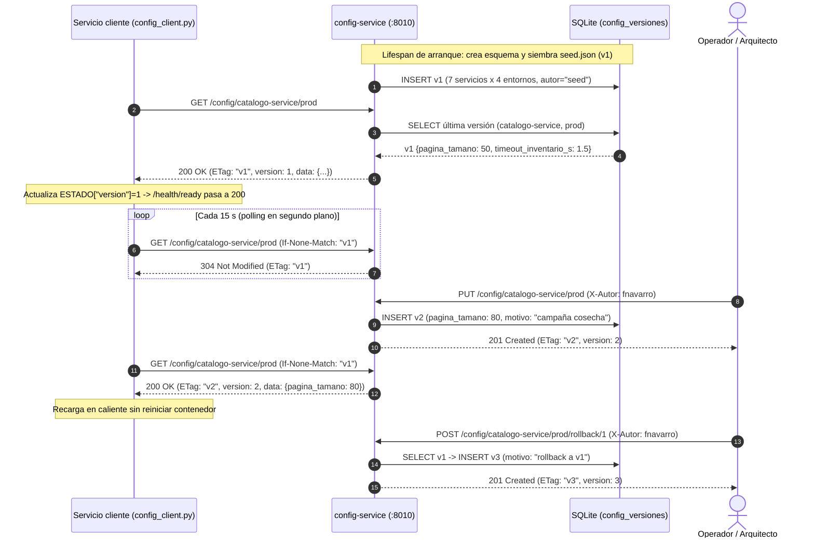
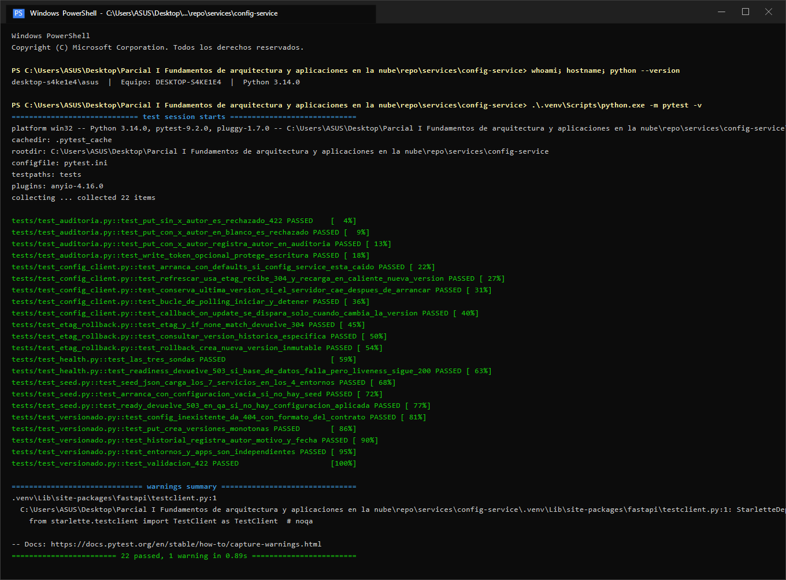
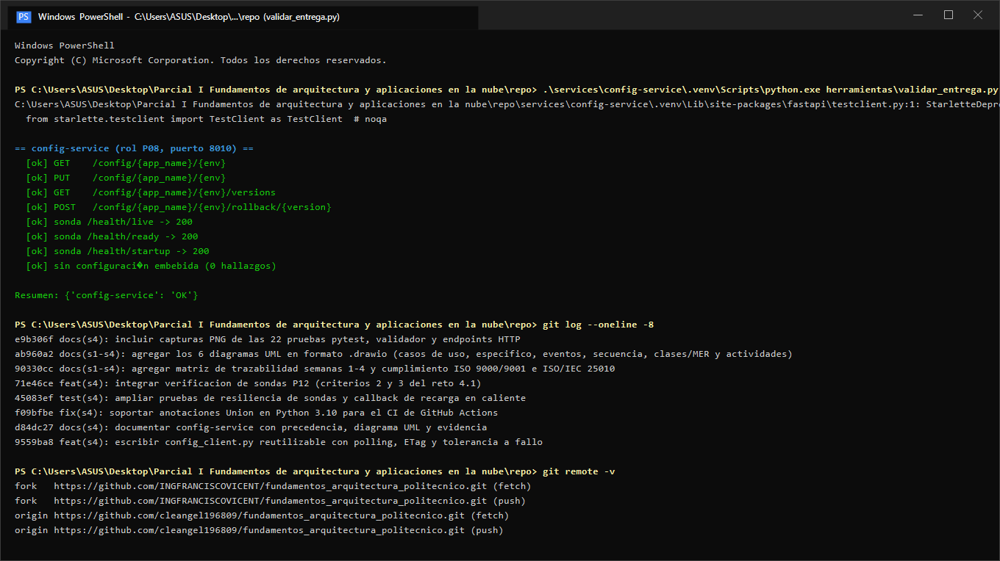
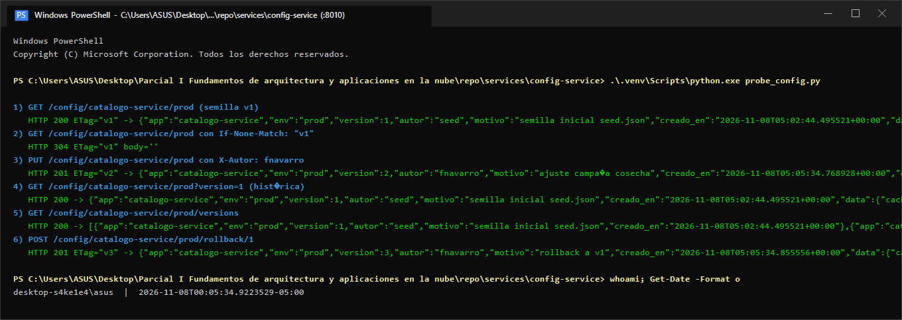
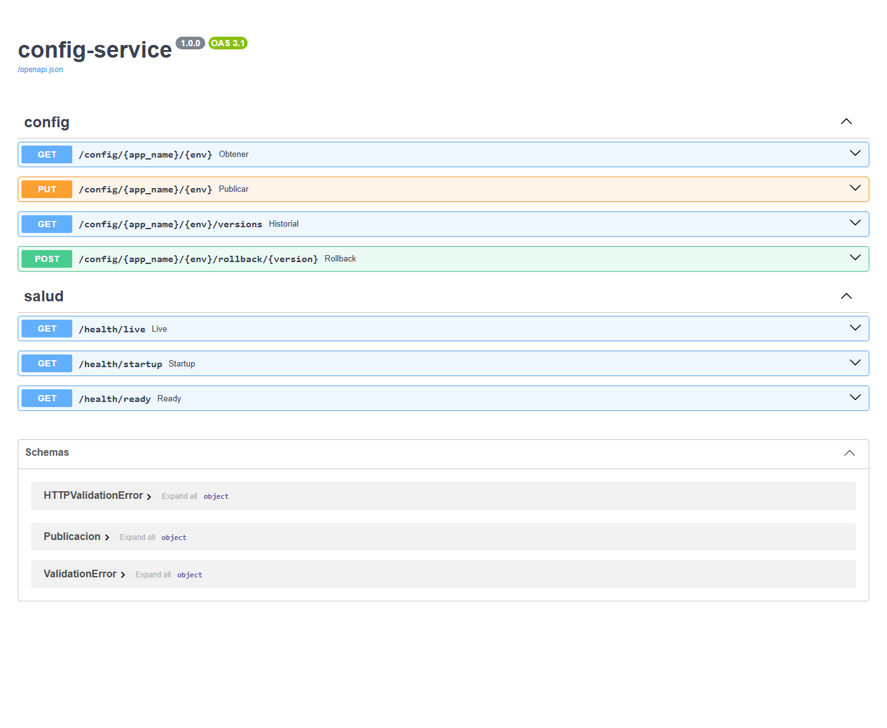

# P08 · `config-service` — Configuración centralizada de PiShop Cloud

- **Estudiante:** Francisco Navarro
- **Curso:** Fundamentos de Arquitectura (1419) · Ciclo VIII · Politécnico Internacional I.E.S.
- **Docente:** Edgar Humberto Angel Millán
- **Paquete:** P08 (`services/config-service`, puerto `8010`) · **Indicador:** 1.2 (escalamiento en la nube) y 1.4 (modelamiento UML)

## Acceso rápido (con el servicio corriendo)

**En Windows, lo más fácil:** doble clic en `services/config-service/iniciar_windows.bat`. Crea el entorno, instala dependencias, arranca el servicio con el token de prueba y abre Swagger solo. Al arrancar, la consola muestra todas estas direcciones para abrirlas con **Ctrl + clic**. **Con VS Code:** *Archivo → Abrir carpeta* → `services/config-service` → **F5** (la primera vez instala dependencias; luego arranca y abre Swagger solo; requiere la extensión Python de Microsoft). También se puede arrancar a mano (sección 7.1).

| Qué | Enlace |
|---|---|
| **App / documentación interactiva (Swagger)** | [http://127.0.0.1:8010/docs](http://127.0.0.1:8010/docs) |
| ¿Está vivo? (sonda *liveness*) | [http://127.0.0.1:8010/health/live](http://127.0.0.1:8010/health/live) |
| ¿Está listo? (sonda *readiness*) | [http://127.0.0.1:8010/health/ready](http://127.0.0.1:8010/health/ready) |
| Contrato OpenAPI (JSON) | [http://127.0.0.1:8010/openapi.json](http://127.0.0.1:8010/openapi.json) |

Token de prueba (entorno `dev`): `pishop-dev-2026` — en `dev` Swagger ya abre autorizado. Los enlaces apuntan al propio PC (`127.0.0.1`), por eso solo abren mientras el servicio está corriendo.

---

## 1. Propósito arquitectónico

En PiShop Cloud existen 7 servicios de dominio desplegados en 4 entornos (`dev`, `qa`, `stg`, `prod`), lo que produce **28 combinaciones de configuración** más los servicios de soporte (`reportes-service` y `descubridor-service`). Siguiendo el **Factor III de The Twelve-Factor App** (Wiggins, 2011) y el patrón *Externalized Configuration* (Richardson, 2018), `config-service` actúa como **fuente única de verdad** para los parámetros operativos no sensibles, ofreciendo:

1. **Versionado inmutable y auditable** en base de datos propia (`SQLite` en tabla `config_versiones`): cada cambio crea una versión monótona creciente (`v1`, `v2`, `v3`…) con `autor`, `motivo` y marca de tiempo UTC (`creado_en`).
2. **Eficiencia de red mediante `ETag` e `If-None-Match`**: cuando la configuración no ha cambiado, el servidor responde `304 Not Modified` sin cuerpo.
3. **Consulta histórica y reversión inmediata (`rollback`)**: `?version=N` permite inspeccionar cualquier versión previa y `POST /rollback/{version}` restaura sus valores publicando una nueva versión auditada sin borrar el historial.
4. **Tolerancia a fallos en el cliente (`config_client.py`)**: si `config-service` no responde al arrancar o durante un ciclo de *polling*, el servicio cliente **no cae**; opera con sus *defaults* o conserva la última versión válida en caché local.

---

## 2. Jerarquía y tabla de precedencia de configuración

Todos los servicios de PiShop Cloud resuelven su configuración con la misma jerarquía de 4 niveles (el nivel de mayor precedencia sobrescribe al anterior):

| Precedencia | Fuente | Ejemplo | Cuándo gana / propósito |
|---|---|---|---|
| **1 (menor)** | **Defaults en código** (`settings.py`) | `pagina_tamano = 20`, `http_timeout_seconds = 2.0` | Contrato mínimo: permite que el servicio arranque aunque no exista `.env` ni `config-service`. |
| **2** | **Archivo local** (`.env`) | `PISHOP_LOG_LEVEL=DEBUG` | Comodidad del desarrollador en su máquina; ignorado en Git (`.gitignore`). |
| **3** | **Variables de entorno** (`PISHOP_*`) | `PISHOP_APP_ENV=prod`, `PISHOP_WRITE_TOKEN=...` | Inyectadas por Docker Compose / Kubernetes (`ConfigMap` y `Secret`). Obligatorias para secretos (`SecretStr`). |
| **4 (mayor)** | **Fuente remota** (`config-service`) | `{"pagina_tamano": 50, "timeout_inventario_s": 1.5}` | Fuente de verdad operativa por `(servicio, entorno)`; recargable en caliente cada 15 s sin redesplegar. |

> **Regla de separación configuración vs. secretos:** ningún secreto (`db_password`, `api_key`, claves de Wompi) se almacena en `seed.json` ni en `config-service`. Los secretos entran exclusivamente por variables de entorno tipadas como `pydantic.SecretStr`.

---

## 3. Variables de configuración del propio `config-service` (`PISHOP_*`)

| Variable | Tipo | Default | Descripción |
|---|---|---|---|
| `PISHOP_SERVICE_NAME` | `str` | `"config-service"` | Nombre lógico del servicio. |
| `PISHOP_HTTP_PORT` | `int` | `8010` | Puerto HTTP de escucha (`1024..65535`). |
| `PISHOP_APP_ENV` | `str` | `"dev"` | Entorno activo (`dev`, `qa`, `stg`, `prod`). |
| `PISHOP_DATABASE_URL` | `str` | `"sqlite+aiosqlite:///./config.db"` | URL de la base propia de versiones (en pruebas `:memory:`). |
| `PISHOP_SEED_PATH` | `str` | `""` (`./seed.json`) | Ruta al archivo semilla con los 7 servicios × 4 entornos. Si no existe, arranca vacío. |
| `PISHOP_API_TOKEN` | `SecretStr` | `SecretStr("")` | Token de la API. **Definido:** todo `/config/*` exige `Authorization: Bearer <token>` (401 si falta). **Vacío:** API pública para pruebas (Swagger sin candados). |
| `PISHOP_WRITE_TOKEN` | `SecretStr` | `SecretStr("")` | Token opcional (`X-Write-Token`) para autorizar escrituras además de `X-Autor`. |
| `PISHOP_HTTP_TIMEOUT_SECONDS` | `float` | `2.0` | Timeout explícito en segundos para llamadas HTTP salientes. |

---

## 4. Contrato HTTP (puerto `8010`)

Si `PISHOP_API_TOKEN` está definido, todas las rutas `/config/*` exigen **`Authorization: Bearer <token>`** → sin token o con token inválido: `401 TOKEN_INVALIDO` (cabecera `WWW-Authenticate: Bearer`). Si no está definido, la API es **pública** (modo de prueba). Las sondas `/health/*`, `/docs` y `/openapi.json` nunca piden token.

| Método | Ruta | Cabeceras / Query | Respuestas |
|---|---|---|---|
| `GET` | `/config/{app_name}/{env}` | `If-None-Match: "vN"` (opcional), `?version=N` (opcional), `?esperar=S` (opcional, 0–30 s, *long-polling*) | `200 OK` con header `ETag: "vN"` · `304 Not Modified` si coincide `If-None-Match` · con `?esperar=S` la petición queda abierta y responde `200` **en cuanto** llega un `PUT`/rollback, o `304` al agotar `S` · `404` si no existe |
| `PUT` | `/config/{app_name}/{env}` | **`X-Autor` obligatorio** (auditoría) | `201 Created` con `ETag: "vN+1"` · `422` si falta `X-Autor` o el cuerpo es inválido · `401` si `PISHOP_WRITE_TOKEN` está activo y no coincide |
| `GET` | `/config/{app_name}/{env}/versions` | — | `200 OK` lista ordenada de versiones (`version`, `autor`, `motivo`, `creado_en`) · `404` si no hay historial |
| `POST` | `/config/{app_name}/{env}/rollback/{version}` | `X-Autor` (default `sistema-rollback`) | `201 Created` publica versión `N+1` copiando los datos de `version` con motivo `"rollback a v{version}"` · `404` si la versión objetivo no existe |
| `GET` | `/config/{app_name}/{env}/eventos` | — | `200` `text/event-stream` (*Server-Sent Events*): emite la versión vigente y luego **cada cambio al instante** (evento `config`, `id` = versión) |
| `GET` | `/health/live` | — | `200 OK` sonda *liveness* (local y barata, no toca base de datos) |
| `GET` | `/health/startup` | — | `200 OK` / `503` sonda *startup* (indica si el `lifespan` terminó de crear esquema y cargar `seed.json`) |
| `GET` | `/health/ready` | — | `200 OK` / `503` sonda *readiness* (verifica `SELECT 1` en SQLite y expone `config_version`) |

### 4.1 Token de la API (`Authorization: Bearer`)

- El token entra **solo** por la variable de entorno `PISHOP_API_TOKEN`, tipada como `SecretStr` (no se imprime en logs ni en `repr`); no hay ningún valor escrito en el código.
- `verificar_token()` en `app/main.py` es una dependencia de FastAPI aplicada a las 5 rutas `/config/*`; compara con `secrets.compare_digest` (tiempo constante, evita ataques de temporización).
- **Dos modos:** sin `PISHOP_API_TOKEN` la API es **pública** para que el docente pruebe sin clave (el OpenAPI no declara seguridad, así que Swagger no muestra candados y las respuestas salen 200/201). Con `PISHOP_API_TOKEN` definido (qa/stg/prod, o `set PISHOP_API_TOKEN=pishop-dev-2026` en local) la API exige el token y Swagger muestra el botón *Authorize*.
- Las sondas quedan libres porque Docker/Kubernetes y Consul deben poder consultarlas sin credenciales.
- `config_client.py` envía el token: parámetro `api_token=` o variable `PISHOP_CONFIG_SERVICE_TOKEN` en el servicio cliente.
- En Swagger (`/docs`) aparece el botón **Authorize** (esquema `HTTPBearer`).
- **Para probar (entorno `dev`):** el token de prueba es **`pishop-dev-2026`** (ver `.env.example`). En `dev`, `/docs` abre **ya autorizado** con el token configurado y con *Try it out* activo y ejemplos precargados (`catalogo-service`, `prod`, `X-Autor: fnavarro` y un cuerpo de ejemplo), así que se pueden ingresar datos y ejecutar sin escribir la clave. En `qa`, `stg` y `prod` el token **no** se inyecta en la página: hay que pulsar *Authorize* y escribirlo.
- En `docker compose` se debe agregar `PISHOP_API_TOKEN` a config-service y `PISHOP_CONFIG_SERVICE_TOKEN` a los servicios que lo consumen, ambos desde el archivo `.env` (coordinar con P12).

```bash
curl -i http://127.0.0.1:8010/config/catalogo-service/prod                                  # 401
curl -i -H "Authorization: Bearer $PISHOP_API_TOKEN" http://127.0.0.1:8010/config/catalogo-service/prod   # 200
```

### 4.2 Propagación en tiempo real de un `PUT`

Un `PUT` o un rollback despierta de inmediato (con un `asyncio.Condition`) a todas las peticiones que esperan cambios:

- **Long-polling (lo usa `config_client.py`):** el cliente envía `GET ...?esperar=25` con `If-None-Match: "vN"`. Si no hay cambios, el servidor retiene la petición; cuando llega el `PUT` responde `200` con `vN+1` en milisegundos. Si pasan 25 s sin cambios responde `304` y el cliente vuelve a esperar. Medido en local: el `GET` en espera respondió a los 1,0 s, justo cuando se envió el `PUT`.
- **SSE (canal de eventos en vivo):** `curl -N -H "Authorization: Bearer $PISHOP_API_TOKEN" http://127.0.0.1:8010/config/catalogo-service/prod/eventos` y publicar un `PUT` desde `/docs`; el evento aparece al instante.
- **Respaldo:** si el servidor no soporta long-polling o falla, el cliente vuelve al polling clásico cada 15 s (`poll_seconds`).
- **Alcance:** el aviso es en memoria del proceso; con varias réplicas de config-service cada réplica avisa a sus propios clientes y el polling de respaldo cubre la diferencia (para avisar entre réplicas se usaría Redis Pub/Sub, ya disponible en el compose).

---

## 5. Diagramas UML y de Arquitectura (Mermaid + Archivos `.drawio` para draw.io)

Dentro de la carpeta [`diagramas/`](diagramas/) de este paquete se incluyen todos los diagramas en formato nativo **`.drawio`** (listos para abrir en https://app.diagrams.net o en la aplicación de escritorio **draw.io**):

| Archivo en `services/config-service/diagramas/` | Vista UML / Arquitectónica |
|---|---|
| [`00_TODOS_LOS_DIAGRAMAS_P08.drawio`](diagramas/00_TODOS_LOS_DIAGRAMAS_P08.drawio) | **Libro multipágina** con los 6 diagramas en pestañas dentro de un solo archivo `.drawio`. |
| [`01_casos_de_uso_general.drawio`](diagramas/01_casos_de_uso_general.drawio) | **Diagrama de Casos de Uso General** (actores: Microservicio Cliente, Arquitecto/Operador DevOps, Consul/Healthcheck, GitOps `seed.json`, SQLite; `CU-01` a `CU-09`). |
| [`02_caso_de_uso_especifico.drawio`](diagramas/02_caso_de_uso_especifico.drawio) | **Diagrama de Caso de Uso Específico (`CU-03`)** con relaciones `<<include>>`, `<<extend>>` y ficha técnica completa de precondiciones, flujo principal, alternos y postcondiciones. |
| [`03_orientado_a_eventos.drawio`](diagramas/03_orientado_a_eventos.drawio) | **Diagrama Orientado a Eventos (EDA)**: productores, eventos (`ConfigSembrada`, `ConfigVersionPublicada`, `ConfigRevertida`, `PedidoCreado`), registro *append-only*, `ETag` y reacción *hot reload* en clientes. |
| [`04_secuencia.drawio`](diagramas/04_secuencia.drawio) | **Diagrama UML de Secuencia**: arranque `lifespan`, *polling* con `If-None-Match` (`304`), `PUT` auditado con `X-Autor`, recarga en caliente y `POST /rollback/{v}`. |
| [`05_clases_y_mer.drawio`](diagramas/05_clases_y_mer.drawio) | **Diagrama UML de Clases y Modelo Entidad-Relación (MER)**: `Settings`, `Publicacion`, `Repositorio`, `VersionConfig`, `ConfigClient` y tabla física SQLite `config_versiones`. |
| [`06_actividades.drawio`](diagramas/06_actividades.drawio) | **Diagrama UML de Actividades** con 3 carriles (*swimlanes*: Cliente, API FastAPI y SQLite) y decisiones para `GET`, `PUT`/`Rollback`, `304`, `404`, `422` y tolerancia a fallos. |

### 5.1 Vista rápida en Mermaid — Secuencia de arranque, *polling* con `ETag`, recarga en caliente y *rollback*



---

## 6. Uso del cliente reutilizable (`config_client.py`)

Cualquier servicio compañero (P01..P10) puede consumir `config-service` instanciando `ConfigClient` en su `lifespan`:

```python
from app.config_client import ConfigClient

cliente_cfg = ConfigClient(
    base_url=str(settings.config_service_url),
    service_name=settings.service_name,
    app_env=settings.app_env,
    defaults={"pagina_tamano": 20, "timeout_inventario_s": 3.0},
    poll_seconds=settings.config_poll_seconds,
    timeout_seconds=settings.http_timeout_seconds,
    estado_externo=ESTADO,  # sincroniza ESTADO["config_version"] para /health/ready
)
# En el lifespan:
await cliente_cfg.iniciar()
yield
await cliente_cfg.detener()
```

---

## 7. Cómo ejecutar y verificar

### 7.1 Ejecución local

Opción rápida en Windows: doble clic en `iniciar_windows.bat` (esta misma carpeta). Opción manual:

```bash
cd services/config-service
python -m venv .venv
.venv/Scripts/pip install -r requirements.txt
set PISHOP_API_TOKEN=<un-token-largo-y-aleatorio>        # PowerShell: $env:PISHOP_API_TOKEN="..."
.venv/Scripts/uvicorn app.main:app --host 0.0.0.0 --port 8010
```

### 7.2 Ejecución con Docker Compose

```bash
docker compose up -d config-service
```

### 7.3 Pruebas automatizadas (`pytest`) y validador del curso

```bash
cd services/config-service
pytest -q
cd ../..
python herramientas/validar_entrega.py config-service
```

---

## 8. Evidencia reproducible (Salidas de consola + Capturas de pantalla PNG + Swagger UI)

En la carpeta [`evidencias/`](evidencias/) se encuentran las **4 capturas de pantalla (`.png`)** tomadas directamente en este equipo (`DESKTOP-S4KE1E4`), incluyendo la interfaz web **Swagger UI (`/docs`)**:

- 
- 
- 
- 

### 8.1 Salida de `validar_entrega.py`

```text
== config-service (rol P08, puerto 8010) ==
  [ok] GET    /config/{app_name}/{env}
  [ok] PUT    /config/{app_name}/{env}
  [ok] GET    /config/{app_name}/{env}/versions
  [ok] POST   /config/{app_name}/{env}/rollback/{version}
  [ok] sonda /health/live -> 200
  [ok] sonda /health/ready -> 200
  [ok] sonda /health/startup -> 200
  [ok] sin configuración embebida (0 hallazgos)

Resumen: {'config-service': 'OK'}
```

### 8.2 Salida de `pytest` (pruebas sin servicios externos)

```text
$ pytest -v
tests/test_auditoria.py::test_put_sin_x_autor_es_rechazado_422 PASSED
tests/test_auditoria.py::test_put_con_x_autor_en_blanco_es_rechazado PASSED
tests/test_auditoria.py::test_put_con_x_autor_registra_autor_en_auditoria PASSED
tests/test_auditoria.py::test_write_token_opcional_protege_escritura PASSED
tests/test_config_client.py::test_arranca_con_defaults_si_config_service_esta_caido PASSED
tests/test_config_client.py::test_refrescar_usa_etag_recibe_304_y_recarga_en_caliente_nueva_version PASSED
tests/test_config_client.py::test_conserva_ultima_version_si_el_servidor_cae_despues_de_arrancar PASSED
tests/test_config_client.py::test_bucle_de_polling_iniciar_y_detener PASSED
tests/test_config_client.py::test_callback_on_update_se_dispara_solo_cuando_cambia_la_version PASSED
tests/test_etag_rollback.py::test_etag_y_if_none_match_devuelve_304 PASSED
tests/test_etag_rollback.py::test_consultar_version_historica_especifica PASSED
tests/test_etag_rollback.py::test_rollback_crea_nueva_version_inmutable PASSED
tests/test_health.py::test_las_tres_sondas PASSED
tests/test_health.py::test_readiness_devuelve_503_si_base_de_datos_falla_pero_liveness_sigue_200 PASSED
tests/test_seed.py::test_seed_json_carga_los_7_servicios_en_los_4_entornos PASSED
tests/test_seed.py::test_arranca_con_configuracion_vacia_si_no_hay_seed PASSED
tests/test_seed.py::test_ready_devuelve_503_en_qa_si_no_hay_configuracion_aplicada PASSED
tests/test_versionado.py::test_config_inexistente_da_404_con_formato_del_contrato PASSED
tests/test_versionado.py::test_put_crea_versiones_monotonas PASSED
tests/test_versionado.py::test_historial_registra_autor_motivo_y_fecha PASSED
tests/test_versionado.py::test_entornos_y_apps_son_independientes PASSED
tests/test_versionado.py::test_validacion_422 PASSED
22 passed in 0.89s
```

Tras agregar la propagación en tiempo real (4 pruebas nuevas en `tests/test_tiempo_real.py`):

```text
tests/test_tiempo_real.py::test_long_polling_recibe_el_put_al_instante PASSED
tests/test_tiempo_real.py::test_long_polling_sin_cambios_responde_304_al_agotar_la_espera PASSED
tests/test_tiempo_real.py::test_config_client_recarga_en_tiempo_real_sin_esperar_el_polling PASSED
tests/test_tiempo_real.py::test_eventos_sse_emite_version_vigente_y_cada_cambio PASSED
26 passed
```

Tras agregar el token obligatorio de la API (6 pruebas nuevas en `tests/test_token.py`):

```text
tests/test_token.py::test_sin_token_todo_config_responde_401 PASSED
tests/test_token.py::test_token_incorrecto_responde_401 PASSED
tests/test_token.py::test_token_correcto_permite_leer_y_escribir PASSED
tests/test_token.py::test_sondas_no_exigen_token PASSED
tests/test_token.py::test_sin_token_configurado_la_api_queda_cerrada_503 PASSED
tests/test_token.py::test_config_client_envia_el_token_como_bearer PASSED
32 passed
```

Swagger listo para probar (4 pruebas nuevas en `tests/test_docs.py`): *Try it out* activo, ejemplos en el OpenAPI, autorizado solo en `dev` y sin exponer el token fuera de `dev` → **36 passed**.

Modo público sin token (pruebas en `tests/test_token.py`): sin `PISHOP_API_TOKEN` el `PUT`/`GET` responden 201/200 y el OpenAPI no tiene candados; con token, sí → **37 passed**.

> Las salidas de 8.3 se capturaron antes de agregar el token; hoy cada petición a `/config/*` lleva además `Authorization: Bearer <token>`.

### 8.3 Evidencia de peticiones HTTP (`ETag`, `304`, `PUT` con `X-Autor`, `?version=1`, `/versions` y `rollback`)

```text
1) GET /config/catalogo-service/prod (semilla v1)
   HTTP 200 ETag="v1" -> {"app":"catalogo-service","env":"prod","version":1,"autor":"seed","motivo":"semilla inicial seed.json","creado_en":"2026-11-05T23:20:36.636318+00:00","data":{"cache_ttl_s":300,"flag_promos_navidad":true,"log_level":"INFO","pagina_tamano":50,"timeout_inventario_s":1.5}}

2) GET /config/catalogo-service/prod con If-None-Match: "v1"
   HTTP 304 ETag="v1" body=''

3) PUT /config/catalogo-service/prod con X-Autor: fnavarro
   HTTP 201 ETag="v2" -> {"app":"catalogo-service","env":"prod","version":2,"autor":"fnavarro","motivo":"ajuste campaña cosecha","creado_en":"2026-11-05T23:23:54.922734+00:00","data":{"flag_promos_navidad":true,"pagina_tamano":80,"timeout_inventario_s":1.2}}

4) GET /config/catalogo-service/prod?version=1 (histórica)
   HTTP 200 -> {"app":"catalogo-service","env":"prod","version":1,"autor":"seed","motivo":"semilla inicial seed.json","creado_en":"2026-11-05T23:20:36.636318+00:00","data":{"cache_ttl_s":300,"flag_promos_navidad":true,"log_level":"INFO","pagina_tamano":50,"timeout_inventario_s":1.5}}

5) GET /config/catalogo-service/prod/versions
   HTTP 200 -> [{"app":"catalogo-service","env":"prod","version":1,"autor":"seed","motivo":"semilla inicial seed.json","creado_en":"2026-11-05T23:20:36.636318+00:00"},{"app":"catalogo-service","env":"prod","version":2,"autor":"fnavarro","motivo":"ajuste campaña cosecha","creado_en":"2026-11-05T23:23:54.922734+00:00"}]

6) POST /config/catalogo-service/prod/rollback/1
   HTTP 201 ETag="v3" -> {"app":"catalogo-service","env":"prod","version":3,"autor":"fnavarro","motivo":"rollback a v1","creado_en":"2026-11-05T23:23:55.048159+00:00","data":{"cache_ttl_s":300,"flag_promos_navidad":true,"log_level":"INFO","pagina_tamano":50,"timeout_inventario_s":1.5}}
```

---

## 9. Decisiones arquitectónicas y *trade-offs*

1. **Historial inmutable (*append-only*) frente a sobrescritura en sitio (`UPDATE`)**:
   - *Decisión:* tanto `PUT` como `POST /rollback/{version}` insertan una nueva fila `N+1` en `config_versiones`.
   - *Justificación:* en un incidente de producción es indispensable cruzar la línea de tiempo con cada cambio aplicado; si `rollback` borrara versiones intermedias, se perdería la trazabilidad de qué valor causó el fallo.
2. **Long-polling con `ETag` (`If-None-Match` + `?esperar=25`) frente a *push* por webhooks y frente a polling simple**:
   - *Decisión:* el cliente deja abierta una petición condicional; el servidor responde en cuanto hay una versión nueva (tiempo real) o `304` a los 25 s. Respaldo: polling cada 15 s.
   - *Trade-off:* se obtiene propagación casi inmediata sin acoplamiento inverso (el servidor no necesita conocer las IPs dinámicas de las réplicas, como sí exigirían los webhooks), a cambio de mantener una conexión abierta por cliente. Con polling simple la ventana de convergencia era de hasta 15 s.
3. **Resiliencia ante caída del servidor de configuración**:
   - *Decisión:* `ConfigClient` captura `httpx.HTTPError` con timeout explícito (`2.0 s`) y conserva el último diccionario válido o los *defaults* de código.
   - *Justificación:* evita que `config-service` se convierta en un punto único de falla (*Single Point of Failure*) que impida el arranque o tumbe a los 7 servicios de PiShop Cloud.

---

## 10. Evidencia de los contenidos de las Semanas 1 a 4 y Normas ISO (ISO 9000 / ISO 9001 e ISO/IEC 25010)

### 10.1 Trazabilidad por semana del curso aplicada a `config-service` (P08)

| Semana | Contenido del curso | Cómo lo evidencia y aplica P08 (`config-service`) |
|---|---|---|
| **Semana 1** | Atributos de calidad **ISO/IEC 25010**, *trade-offs*, C4/UML y antídoto del monolito distribuido | Base de datos propia (`config_versiones` en SQLite) sin compartir tablas con ningún otro servicio; diagrama UML de secuencia como código (Mermaid); *trade-off* explícito entre consistencia inmediata y desacoplamiento mediante *polling* con `ETag`. |
| **Semana 2** | Partición vertical/horizontal, **DDD** (*bounded contexts*), tríada Core / Compuesto / API / Soporte | `config-service` es un servicio de **Soporte transversal** con su propio contexto delimitado de gobierno de configuración; separa el esquema de validación HTTP (`Publicacion` en Pydantic) de la entidad persistida (`VersionConfig` en `store.py`). |
| **Semana 3** | Cubo de escalabilidad (**X, Y, Z**), timeouts explícitos, idempotencia y disponibilidad compuesta | Permite que los servicios escalen en el **eje X** (múltiples réplicas leyendo la misma fuente de verdad sin deriva de configuración); `config_client.py` usa `httpx.AsyncClient` con **timeout explícito (`2.0 s`)** y degradación elegante (caché local + *defaults*) para **no** restar disponibilidad compuesta a la ruta crítica del checkout. |
| **Semana 4** | **Factor III (Twelve-Factor App)**, `ETag` / `304`, historial versionado, `rollback` y sondas `live` / `ready` / `startup` | Configuración 100 % externalizada por `PISHOP_*` (`frozen=True`) y secretos con `SecretStr`; `GET /config/{app}/{env}` con `ETag`/`If-None-Match` (`304`); `PUT` auditado con `X-Autor`; `POST /rollback/{version}`; semilla `seed.json` (7 servicios × 4 entornos) y las 3 sondas diferenciadas. |

### 10.2 Cumplimiento de la familia **ISO 9000 / ISO 9001:2015** (Gestión de la Calidad) e **ISO/IEC 25010:2023** (Calidad de Producto de Software)

| Norma / Cláusula | Principio de calidad | Implementación verificable en `services/config-service/` |
|---|---|---|
| **ISO 9000 / ISO 9001 §7.5** (*Información documentada y control de cambios*) | Todo cambio operativo debe estar identificado, versionado, con autor, motivo, fecha y posibilidad de reversión sin pérdida de trazabilidad. | Tabla inmutable `config_versiones` (*append-only*): cada `PUT` exige cabecera `X-Autor`, registra `motivo`, `creado_en` (UTC) y número de `version` monótono; `POST /rollback/{version}` restaura valores creando una nueva versión auditada. |
| **ISO 9000 / ISO 9001 §8.5.2** (*Identificación y trazabilidad*) | Identificación única de cada elemento de configuración por aplicación, entorno y versión. | Clave única compuesta `(app, env, version)`, etiqueta HTTP `ETag: "vN"` y reporte de `config_version` en `/health/ready`. |
| **ISO 9000 / ISO 9001 §9.1 y §10.2** (*Seguimiento, medición, no conformidad y acción correctiva*) | Verificación objetiva mediante pruebas automatizadas y corrección inmediata ante fallos. | Suite de **37 pruebas `pytest`**, validador `validar_entrega.py`, auditoría de 0 secretos embebidos y reversión inmediata con `/rollback/{version}`. |
| **ISO/IEC 25010 — Fiabilidad** (*Tolerancia a fallos y recuperabilidad*) | El sistema sigue operando aunque falle un componente de soporte. | `ConfigClient` captura `httpx.HTTPError` y mantiene operando al servicio con `defaults` o con la última versión válida en caché local; `/health/live` (`200`) se separa de `/health/ready` (`503`). |
| **ISO/IEC 25010 — Eficiencia de desempeño** (*Utilización de recursos*) | Minimizar tráfico y procesamiento innecesario en red. | Uso de `If-None-Match` y respuesta `304 Not Modified` sin cuerpo cuando la versión vigente no ha cambiado. |
| **ISO/IEC 25010 — Seguridad** (*Confidencialidad, integridad y no repudio*) | Separación entre parámetros y secretos, e integridad del rastro de auditoría. | Token obligatorio de la API (`Authorization: Bearer`, `PISHOP_API_TOKEN` como `SecretStr`, comparación en tiempo constante y falla cerrada), secretos tipados con `SecretStr` (`PISHOP_WRITE_TOKEN`), rechazo `422` si falta `X-Autor` (`AUTOR_VACIO`) y `401` si el token de escritura no coincide. |
| **ISO/IEC 25010 — Mantenibilidad y Flexibilidad** (*Modularidad y adaptabilidad*) | Un mismo artefacto corre en cualquier entorno sin tocar el código. | Separación `main.py` / `store.py` / `settings.py` / `config_client.py` y promoción entre `dev`, `qa`, `stg` y `prod` mediante variables `PISHOP_*` y `seed.json`. |

---

## 11. Declaración de uso de IA generativa

Conforme a la sección 5 y 7 del enunciado del Parcial 1:
- **Herramienta utilizada:** asistente de codificación con IA como apoyo en la estructuración del repositorio SQLite, redacción de pruebas `pytest` y formato del documento `README.md`.
- **Qué verificó el estudiante:** revisión línea por línea de los endpoints en `app/main.py`, el almacén versionado en `app/store.py`, la lógica de `ETag` / `304` y `rollback`, el cliente `app/config_client.py`, la semilla `seed.json` para los 7 servicios en 4 entornos, la ejecución local de las 22 pruebas unitarias con `pytest` y la validación del contrato mediante `python herramientas/validar_entrega.py config-service`.

---

## 12. Referencias (APA 7)

- International Organization for Standardization. (2015). *ISO 9000:2015 Quality management systems — Fundamentals and vocabulary*. ISO.
- International Organization for Standardization. (2015). *ISO 9001:2015 Quality management systems — Requirements*. ISO.
- International Organization for Standardization. (2023). *ISO/IEC 25010:2023 Systems and software engineering — Systems and software Quality Requirements and Evaluation (SQuaRE) — Product quality model*. ISO.
- Newman, S. (2021). *Building Microservices: Designing Fine-Grained Systems* (2.ª ed.). O'Reilly Media.
- Nygard, M. T. (2018). *Release It! Design and Deploy Production-Ready Software* (2.ª ed.). Pragmatic Bookshelf.
- Richardson, C. (2018). *Microservices Patterns: With Examples in Java*. Manning Publications.
- Wiggins, A. (2011). *The Twelve-Factor App: III. Config*. https://12factor.net/config
