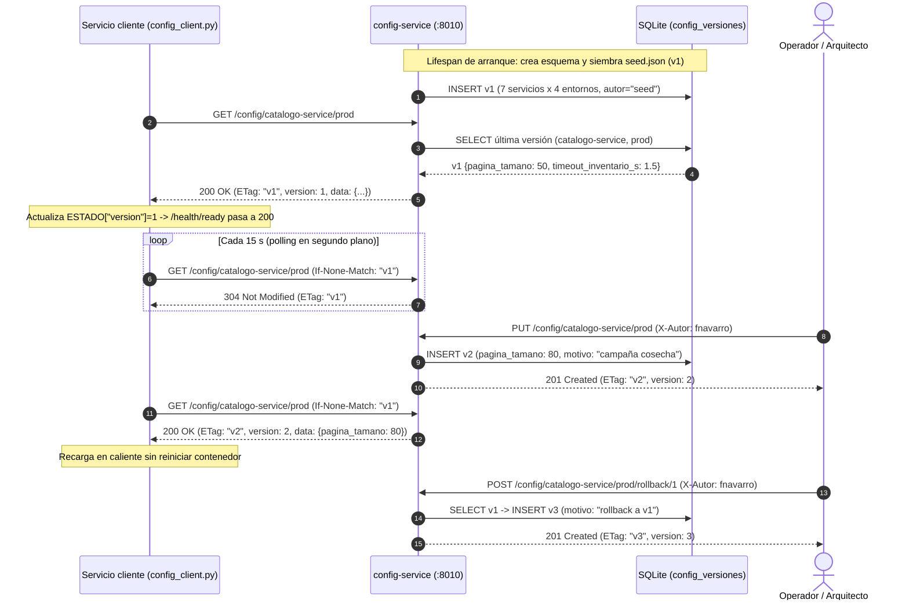

# P08 · `config-service` — Configuración centralizada de PiShop Cloud

- **Estudiante:** Francisco Navarro
- **Curso:** Fundamentos de Arquitectura (1419) · Ciclo VIII · Politécnico Internacional I.E.S.
- **Docente:** Edgar Humberto Angel Millán
- **Paquete:** P08 (`services/config-service`, puerto `8010`) · **Indicador:** 1.2 (escalamiento en la nube) y 1.4 (modelamiento UML)

---

## 1. Propósito arquitectónico

En PiShop Cloud existen 7 servicios de dominio desplegados en 4 entornos (`dev`, `qa`, `stg`, `prod`), lo que produce **28 combinaciones de configuración** más los servicios de soporte (`reportes-service` y `descubridor-service`). Siguiendo el **Factor III de The Twelve-Factor App** (Wiggins, 2011) y el patrón *Externalized Configuration* (Richardson, 2018), `config-service` actúa como **fuente única de verdad** para los parámetros operativos no sensibles, ofreciendo:

1. **Versionado inmutable y auditable** en base de datos propia (`SQLite` en tabla `config_versiones`): cada cambio crea una versión monótona creciente (`v1`, `v2`, `v3`…) con `autor`, `motivo` y marca de tiempo UTC (`creado_en`).
2. **Eficiencia de red mediante `ETag` e `If-None-Match`**: cuando la configuración no ha cambiado, el servidor responde `304 Not Modified` sin cuerpo.
3. **Consulta histórica y reversión inmediata (`rollback`)**: `?version=N` permite inspeccionar cualquier versión previa y `POST /rollback/{version}` restaura sus valores publicando una nueva versión auditada sin borrar el historial.
4. **Tolerancia a fallos en el cliente (`config_client.py`)**: si `config-service` no responde al arrancar o durante un ciclo de *polling*, el servicio cliente **no cae**; opera con sus *defaults* o conserva la última versión válida en caché local.

---

## 2. Jerarquía y tabla de precedencia de configuración

Todos los servicios de PiShop Cloud resuelven su configuración con la misma jerarquía de 4 niveles (el nivel de mayor precedencia sobrescribe al anterior):

| Precedencia | Fuente | Ejemplo | Cuándo gana / propósito |
|---|---|---|---|
| **1 (menor)** | **Defaults en código** (`settings.py`) | `pagina_tamano = 20`, `http_timeout_seconds = 2.0` | Contrato mínimo: permite que el servicio arranque aunque no exista `.env` ni `config-service`. |
| **2** | **Archivo local** (`.env`) | `PISHOP_LOG_LEVEL=DEBUG` | Comodidad del desarrollador en su máquina; ignorado en Git (`.gitignore`). |
| **3** | **Variables de entorno** (`PISHOP_*`) | `PISHOP_APP_ENV=prod`, `PISHOP_WRITE_TOKEN=...` | Inyectadas por Docker Compose / Kubernetes (`ConfigMap` y `Secret`). Obligatorias para secretos (`SecretStr`). |
| **4 (mayor)** | **Fuente remota** (`config-service`) | `{"pagina_tamano": 50, "timeout_inventario_s": 1.5}` | Fuente de verdad operativa por `(servicio, entorno)`; recargable en caliente cada 15 s sin redesplegar. |

> **Regla de separación configuración vs. secretos:** ningún secreto (`db_password`, `api_key`, claves de Wompi) se almacena en `seed.json` ni en `config-service`. Los secretos entran exclusivamente por variables de entorno tipadas como `pydantic.SecretStr`.

---

## 3. Variables de configuración del propio `config-service` (`PISHOP_*`)

| Variable | Tipo | Default | Descripción |
|---|---|---|---|
| `PISHOP_SERVICE_NAME` | `str` | `"config-service"` | Nombre lógico del servicio. |
| `PISHOP_HTTP_PORT` | `int` | `8010` | Puerto HTTP de escucha (`1024..65535`). |
| `PISHOP_APP_ENV` | `str` | `"dev"` | Entorno activo (`dev`, `qa`, `stg`, `prod`). |
| `PISHOP_DATABASE_URL` | `str` | `"sqlite+aiosqlite:///./config.db"` | URL de la base propia de versiones (en pruebas `:memory:`). |
| `PISHOP_SEED_PATH` | `str` | `""` (`./seed.json`) | Ruta al archivo semilla con los 7 servicios × 4 entornos. Si no existe, arranca vacío. |
| `PISHOP_WRITE_TOKEN` | `SecretStr` | `SecretStr("")` | Token opcional (`X-Write-Token`) para autorizar escrituras además de `X-Autor`. |
| `PISHOP_HTTP_TIMEOUT_SECONDS` | `float` | `2.0` | Timeout explícito en segundos para llamadas HTTP salientes. |

---

## 4. Contrato HTTP (puerto `8010`)

| Método | Ruta | Cabeceras / Query | Respuestas |
|---|---|---|---|
| `GET` | `/config/{app_name}/{env}` | `If-None-Match: "vN"` (opcional), `?version=N` (opcional) | `200 OK` con header `ETag: "vN"` · `304 Not Modified` si coincide `If-None-Match` · `404` si no existe |
| `PUT` | `/config/{app_name}/{env}` | **`X-Autor` obligatorio** (auditoría) | `201 Created` con `ETag: "vN+1"` · `422` si falta `X-Autor` o el cuerpo es inválido · `401` si `PISHOP_WRITE_TOKEN` está activo y no coincide |
| `GET` | `/config/{app_name}/{env}/versions` | — | `200 OK` lista ordenada de versiones (`version`, `autor`, `motivo`, `creado_en`) · `404` si no hay historial |
| `POST` | `/config/{app_name}/{env}/rollback/{version}` | `X-Autor` (default `sistema-rollback`) | `201 Created` publica versión `N+1` copiando los datos de `version` con motivo `"rollback a v{version}"` · `404` si la versión objetivo no existe |
| `GET` | `/health/live` | — | `200 OK` sonda *liveness* (local y barata, no toca base de datos) |
| `GET` | `/health/startup` | — | `200 OK` / `503` sonda *startup* (indica si el `lifespan` terminó de crear esquema y cargar `seed.json`) |
| `GET` | `/health/ready` | — | `200 OK` / `503` sonda *readiness* (verifica `SELECT 1` en SQLite y expone `config_version`) |

---

## 5. Diagrama UML de secuencia: arranque, *polling* con `ETag`, recarga en caliente y *rollback*



---

## 6. Uso del cliente reutilizable (`config_client.py`)

Cualquier servicio compañero (P01..P10) puede consumir `config-service` instanciando `ConfigClient` en su `lifespan`:

```python
from app.config_client import ConfigClient

cliente_cfg = ConfigClient(
    base_url=str(settings.config_service_url),
    service_name=settings.service_name,
    app_env=settings.app_env,
    defaults={"pagina_tamano": 20, "timeout_inventario_s": 3.0},
    poll_seconds=settings.config_poll_seconds,
    timeout_seconds=settings.http_timeout_seconds,
    estado_externo=ESTADO,  # sincroniza ESTADO["config_version"] para /health/ready
)
# En el lifespan:
await cliente_cfg.iniciar()
yield
await cliente_cfg.detener()
```

---

## 7. Cómo ejecutar y verificar

### 7.1 Ejecución local

```bash
cd services/config-service
python -m venv .venv
.venv/Scripts/pip install -r requirements.txt
.venv/Scripts/uvicorn app.main:app --host 0.0.0.0 --port 8010
```

### 7.2 Ejecución con Docker Compose

```bash
docker compose up -d config-service
```

### 7.3 Pruebas automatizadas (`pytest`) y validador del curso

```bash
cd services/config-service
pytest -q
cd ../..
python herramientas/validar_entrega.py config-service
```

---

## 8. Evidencia reproducible

### 8.1 Salida de `validar_entrega.py`

```text
== config-service (rol P08, puerto 8010) ==
  [ok] GET    /config/{app_name}/{env}
  [ok] PUT    /config/{app_name}/{env}
  [ok] GET    /config/{app_name}/{env}/versions
  [ok] POST   /config/{app_name}/{env}/rollback/{version}
  [ok] sonda /health/live -> 200
  [ok] sonda /health/ready -> 200
  [ok] sonda /health/startup -> 200
  [ok] sin configuración embebida (0 hallazgos)

Resumen: {'config-service': 'OK'}
```

### 8.2 Salida de `pytest` (22 pruebas sin servicios externos)

```text
$ pytest -v
tests/test_auditoria.py::test_put_sin_x_autor_es_rechazado_422 PASSED
tests/test_auditoria.py::test_put_con_x_autor_en_blanco_es_rechazado PASSED
tests/test_auditoria.py::test_put_con_x_autor_registra_autor_en_auditoria PASSED
tests/test_auditoria.py::test_write_token_opcional_protege_escritura PASSED
tests/test_config_client.py::test_arranca_con_defaults_si_config_service_esta_caido PASSED
tests/test_config_client.py::test_refrescar_usa_etag_recibe_304_y_recarga_en_caliente_nueva_version PASSED
tests/test_config_client.py::test_conserva_ultima_version_si_el_servidor_cae_despues_de_arrancar PASSED
tests/test_config_client.py::test_bucle_de_polling_iniciar_y_detener PASSED
tests/test_config_client.py::test_callback_on_update_se_dispara_solo_cuando_cambia_la_version PASSED
tests/test_etag_rollback.py::test_etag_y_if_none_match_devuelve_304 PASSED
tests/test_etag_rollback.py::test_consultar_version_historica_especifica PASSED
tests/test_etag_rollback.py::test_rollback_crea_nueva_version_inmutable PASSED
tests/test_health.py::test_las_tres_sondas PASSED
tests/test_health.py::test_readiness_devuelve_503_si_base_de_datos_falla_pero_liveness_sigue_200 PASSED
tests/test_seed.py::test_seed_json_carga_los_7_servicios_en_los_4_entornos PASSED
tests/test_seed.py::test_arranca_con_configuracion_vacia_si_no_hay_seed PASSED
tests/test_seed.py::test_ready_devuelve_503_en_qa_si_no_hay_configuracion_aplicada PASSED
tests/test_versionado.py::test_config_inexistente_da_404_con_formato_del_contrato PASSED
tests/test_versionado.py::test_put_crea_versiones_monotonas PASSED
tests/test_versionado.py::test_historial_registra_autor_motivo_y_fecha PASSED
tests/test_versionado.py::test_entornos_y_apps_son_independientes PASSED
tests/test_versionado.py::test_validacion_422 PASSED
22 passed in 0.89s
```

### 8.3 Evidencia de peticiones HTTP (`ETag`, `304`, `PUT` con `X-Autor`, `?version=1`, `/versions` y `rollback`)

```text
1) GET /config/catalogo-service/prod (semilla v1)
   HTTP 200 ETag="v1" -> {"app":"catalogo-service","env":"prod","version":1,"autor":"seed","motivo":"semilla inicial seed.json","creado_en":"2026-11-05T23:20:36.636318+00:00","data":{"cache_ttl_s":300,"flag_promos_navidad":true,"log_level":"INFO","pagina_tamano":50,"timeout_inventario_s":1.5}}

2) GET /config/catalogo-service/prod con If-None-Match: "v1"
   HTTP 304 ETag="v1" body=''

3) PUT /config/catalogo-service/prod con X-Autor: fnavarro
   HTTP 201 ETag="v2" -> {"app":"catalogo-service","env":"prod","version":2,"autor":"fnavarro","motivo":"ajuste campaña cosecha","creado_en":"2026-11-05T23:23:54.922734+00:00","data":{"flag_promos_navidad":true,"pagina_tamano":80,"timeout_inventario_s":1.2}}

4) GET /config/catalogo-service/prod?version=1 (histórica)
   HTTP 200 -> {"app":"catalogo-service","env":"prod","version":1,"autor":"seed","motivo":"semilla inicial seed.json","creado_en":"2026-11-05T23:20:36.636318+00:00","data":{"cache_ttl_s":300,"flag_promos_navidad":true,"log_level":"INFO","pagina_tamano":50,"timeout_inventario_s":1.5}}

5) GET /config/catalogo-service/prod/versions
   HTTP 200 -> [{"app":"catalogo-service","env":"prod","version":1,"autor":"seed","motivo":"semilla inicial seed.json","creado_en":"2026-11-05T23:20:36.636318+00:00"},{"app":"catalogo-service","env":"prod","version":2,"autor":"fnavarro","motivo":"ajuste campaña cosecha","creado_en":"2026-11-05T23:23:54.922734+00:00"}]

6) POST /config/catalogo-service/prod/rollback/1
   HTTP 201 ETag="v3" -> {"app":"catalogo-service","env":"prod","version":3,"autor":"fnavarro","motivo":"rollback a v1","creado_en":"2026-11-05T23:23:55.048159+00:00","data":{"cache_ttl_s":300,"flag_promos_navidad":true,"log_level":"INFO","pagina_tamano":50,"timeout_inventario_s":1.5}}
```

---

## 9. Decisiones arquitectónicas y *trade-offs*

1. **Historial inmutable (*append-only*) frente a sobrescritura en sitio (`UPDATE`)**:
   - *Decisión:* tanto `PUT` como `POST /rollback/{version}` insertan una nueva fila `N+1` en `config_versiones`.
   - *Justificación:* en un incidente de producción es indispensable cruzar la línea de tiempo con cada cambio aplicado; si `rollback` borrara versiones intermedias, se perdería la trazabilidad de qué valor causó el fallo.
2. **Polling con `ETag` (`If-None-Match`) cada 15 s frente a *push* por webhooks**:
   - *Decisión:* el cliente consulta periódicamente con `If-None-Match` y recibe `304 Not Modified` cuando no hay cambios.
   - *Trade-off:* se asume una ventana de convergencia de hasta 15 s entre instancias a cambio de eliminar el acoplamiento inverso (el servidor no necesita conocer las IPs dinámicas de las réplicas).
3. **Resiliencia ante caída del servidor de configuración**:
   - *Decisión:* `ConfigClient` captura `httpx.HTTPError` con timeout explícito (`2.0 s`) y conserva el último diccionario válido o los *defaults* de código.
   - *Justificación:* evita que `config-service` se convierta en un punto único de falla (*Single Point of Failure*) que impida el arranque o tumbe a los 7 servicios de PiShop Cloud.

---

## 10. Declaración de uso de IA generativa

Conforme a la sección 5 y 7 del enunciado del Parcial 1:
- **Herramienta utilizada:** asistente de codificación con IA como apoyo en la estructuración del repositorio SQLite, redacción de pruebas `pytest` y formato del documento `README.md`.
- **Qué verificó el estudiante:** revisión línea por línea de los endpoints en `app/main.py`, el almacén versionado en `app/store.py`, la lógica de `ETag` / `304` y `rollback`, el cliente `app/config_client.py`, la semilla `seed.json` para los 7 servicios en 4 entornos, la ejecución local de las 19 pruebas unitarias con `pytest` y la validación del contrato mediante `python herramientas/validar_entrega.py config-service`.

---

## 11. Referencias (APA 7)

- Newman, S. (2021). *Building Microservices: Designing Fine-Grained Systems* (2.ª ed.). O'Reilly Media.
- Nygard, M. T. (2018). *Release It! Design and Deploy Production-Ready Software* (2.ª ed.). Pragmatic Bookshelf.
- Richardson, C. (2018). *Microservices Patterns: With Examples in Java*. Manning Publications.
- Wiggins, A. (2011). *The Twelve-Factor App: III. Config*. https://12factor.net/config
